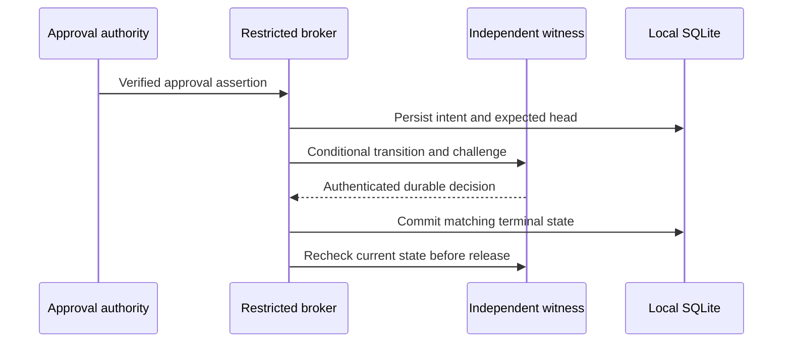

# Independent freshness witness architecture

**Architecture only. Production NO-GO.** No trustworthy independent witness currently exists in the approval path. A synthetic test restored an older valid SQLite backup and demonstrated that the low-level consume primitive could consume the resurrected approval again; it did not enable task execution. `backend/security/task_access.py` still denies task content revalidation. Nothing in this proposal changes that gate or authorizes a feature.

## Scope and threat model

Goal: detect a restored or replaced approval database and prevent a previously consumed or revoked approval from being re-used, even if the application database and its ordinary backups are rolled back. The intended air-gapped deployment has no cloud dependency. A local network inside an organizational air gap is not Internet access, but is still a networked system requiring an independently verified egress policy. Where no independently protected witness can be provisioned, **offline-only operation remains denied** for actions requiring freshness; no local substitute is presented as equivalent.

| Threat | Intended response | Assumptions / limits |
| --- | --- | --- |
| Application crash, SQLite transaction interruption | Keep uncertain operations denied; reconcile using witness terminal status and local durable intent after restart. | SQLite transactions protect their own database under documented storage assumptions, not a multi-store commit. [SQLite atomic commit](https://www.sqlite.org/atomiccommit.html). |
| Restore of older DB, WAL or backup | Witness's independently current head differs or its per-approval terminal state prevents replay; quarantine until reconciled. | Witness state and its independently protected high-water mark must not be restored in the same rollback domain. An authenticated latest response is mandatory. |
| Old approval replay and stale responses | Unique deployment/incarnation and approval IDs, single-use witness transition, authenticated challenge-bound responses and monotonic head checks. | Witness and client trust anchors are independently provisioned. A cached valid signature is not current evidence. |
| Filesystem/database replacement | Trusted broker checks protected file/root identity and DB incarnation; mismatch or unsupported identity denies. | Required Windows handle-relative, reparse, ACL and independent-writer controls are not implemented or verified. A witness does not by itself bind an open file handle. |
| Compromised ordinary app process | Application identity cannot directly mutate broker/witness or impersonate an approver. Witness checks operation and approval-specific authorized assertions. | Compromised app may submit requests, cause denial of service or misuse authority actually delegated to it. The witness cannot decide whether an authorized user genuinely approved a misleading request without a separately verified human-approval workflow. |
| Compromised broker/service identity | Fail closed on detected anomalies; independent observer and audit may detect misuse. | If broker can mint approval assertions or execute effects without mediation, it can misuse that authority. Separate approval authority and protected execution boundary are necessary; this design alone cannot prevent all compromised-broker actions. |
| Local administrator on application host | Independent witness is outside that administrator's control and cannot be silently rolled back by that host. | An admin may tamper with broker binaries, inspect/duplicate credentials, redirect requests, alter clock or perform operations outside the broker. Preventing host-admin compromise needs separate OS/hardware and organizational controls; local client results cannot be trusted merely because witness responses are signed. |
| Correlated backups/snapshots | Database restore is checked against the live witness. Witness rollback is detected by an independently held, non-rollbackable head or triggers quarantine. | Restoring witness and every independent checkpoint together to the same old state is indistinguishable without an external monotonic authority. Never assume independent disks, VMs or separate files imply independent administration. |
| Witness unavailable, stale or split-brain | Deny issue, consume and execution; queue no implicit authorization; preserve existing revoked/consumed records. | Availability is intentionally sacrificed. Revocation requests received during outage are not acknowledged as durable until witness records them; maintain a separate emergency stop that does not rely on witness availability. |
| Power loss between witness, SQLite and external effects | Resolve from durable witness decision and local transaction records; uncertain effects quarantined, never automatically replayed. | No general atomic transaction spans witness, SQLite, filesystem, Chroma and arbitrary external effects. Exactly-once external execution cannot be promised from a witness alone. |

## Option comparison

Every option still requires protected keys, access control, audit and operator procedures. “Offline” below means no cloud/Internet dependency, not necessarily no internal network.

| Option | Independence and rollback/deletion | Complexity, privileges and offline compatibility | Crash/recovery and failure behavior |
| --- | --- | --- | --- |
| Same-host append-only log/sidecar | Normally shares application administrator and backup domain; append-only conventions or hash chains can be truncated or restored together. | Low; local filesystem permissions; fully offline. | Can diagnose an inconsistency only while an independently retained head is available. On missing/divergent log deny; cannot alone detect correlated rollback. |
| Windows Event Log or OS-protected storage | OS access control raises the bar against ordinary users. Local administrators, log clearing, host rollback and restore still matter; not an independently monotonic authority by default. | Moderate; audit policy, event-log rights and retention; offline capable. | Event loss, overwrite, clock issues or whole-host restore must be handled. Useful audit evidence, not a sole freshness witness. |
| TPM-backed NV counter, where actually supported | A correctly provisioned counter can supply hardware-backed monotonic evidence; signature over ordinary state is not a counter. Clear/reprovision, owner privileges, virtual TPM rollback, replacement and backup lifecycle matter. | High and device-specific; TPM access policy, provisioning, possible admin/OEM control, limited resources and rate/availability constraints. Offline. TCG specifications describe NV counters; actual Windows/TBS/OEM availability and lifecycle must be separately verified. [TCG TPM library](https://trustedcomputinggroup.org/wp-content/uploads/Trusted-Platform-Module-2.0-Library-Part-1_Architecture-V185-RC4_12Dec2025.pdf), [Microsoft TBS resources](https://learn.microsoft.com/en-us/windows/win32/tbs/resource-virtualization). | A counter alone does not bind approval state or make multi-store updates atomic. Counter-ahead/DB-ahead and TPM reset/clear must quarantine, with independently authorized re-enrollment. No usable TPM capability is asserted for this deployment. |
| Separately administered offline witness service on same host | Different OS identity and protected process may separate ordinary app access; still shares machine administrator, power failure and potentially snapshot/backup domain. | Medium; restrictive service provisioning and local IPC. Fully disconnected operation possible. | Only suitable if an additional independently protected nonrollbackable head survives host restore and the OS boundary is verified; otherwise same-host correlated rollback remains unresolved. |
| Separate witness host or appliance on isolated organizational network | Can be outside application-host admin and restore domain; independent identity and custody enable stronger rollback detection. Still vulnerable to witness admin/key compromise or correlated restore unless separately protected head/quorum exists. | Higher: dedicated service/device, internal mutual authentication, patching, keys, audit and operational availability. No Internet/cloud required. | Synchronous acknowledged durable CAS before authorization; uncertain outcome denies. Witness backups must not be silently restored; recovery requires separately protected checkpoint and explicit controlled reconciliation. |
| Offline signed checkpoint/recovery records | Signature proves origin/integrity under a trusted key, not that it is the latest checkpoint; old signed records can be replayed. Physical custody can provide an independent domain only with controlled latest-head tracking. | Medium to high; offline custody, rotation and dual control. Works with no network. | Manual transfer and discontinuity create availability and stale-head risks. Useful disaster recovery evidence, not a live freshness guarantee without independently verified newest sequence. |

## Recommended minimum viable architecture

Use **one separately administered witness service on a separate appliance or host on an isolated organizational network**, plus an independently protected, non-rollbackable high-water mark/checkpoint authority for the witness itself. If no distinct protected checkpoint or equivalent independently verified monotonic mechanism exists, the service cannot claim witness rollback resistance and remains unsuitable for authorization. A physical separate witness machine is recommended for clearer administrative and backup separation; it is not, by itself, the security guarantee. For a single machine with no suitable protected anchor, do not enable freshness-dependent actions. This is a proposed operational architecture, not a claim that current SovereignAI implements it.

### Trust, custody and data

- The application worker is untrusted for approval assertions and has no direct write access to the SQLite database, protected roots, witness ledger or credentials. A separately provisioned restricted broker owns the relevant state and provides a narrow authenticated interface. Windows ACLs, handle identities, service identity, broker code/configuration and endpoint verification require independent native evidence. The present prototypes do not provide this deployment boundary.
- Witness custody, witness signing keys, backup authorization and the high-water-mark authority are administered separately from the application host administrator. The witness accepts only narrowly scoped broker requests and signed/verified approval assertions from a separate authority. Operator quorum/dual control applies to witness recovery, key rotation, revocation and re-enrollment. These are organizational assumptions to verify, not inferred properties.
- For each deployment, assign a random deployment ID and incarnation ID; never reset or reuse either silently. Maintain an authenticated append-only state machine with global sequence, predecessor commitment, unique operation ID, approval ID, issue/consume/revoke/expire state, issuer and approver identities, task/conversation/owner and canonical arguments digest, dependency/source generation, policy version, issuance and expiry evidence, and relevant response/decision digest. Keep sensitive data out of the witness; use commitments with an unambiguous versioned encoding and domain separation. No content-derived low-entropy hashes should be assumed confidential.
- A single logical writer with durable compare-and-advance serializes the witness ledger. The witness acknowledges only after its record and independent high-water-mark protocol are durably established; exact device flush semantics, duplicate operation handling, capacity, consistency and key custody require implementation-specific review. Do not rely on a second same-admin local witness file. A signed or authenticated response must bind deployment, current sequence/head, operation and a fresh unpredictable client challenge. A challenge alone does not establish recency if the server is itself rolled back: the witness must first verify its protected high-water mark.
- Use mutually authenticated internal transport with pinned organizational identities and replay protection, or a separately verified local IPC boundary if deployed on a separate protected device. No arbitrary network endpoint, client-supplied role, PID or unsigned request fields establish authority. Credential rotation and revocation, server identity, trusted broker executable/config and secure bootstrapping must be independently designed and tested. Network isolation and egress monitoring remain separate blockers; no rules or service are enabled by this proposal.

### Approval operations and ordering

All transitions share an immutable approval ID, canonical request digest and unique non-reusable operation ID. Identity, source/task provenance, ownership, current clearance, policy, expiry and tool restrictions are independently revalidated at the authorization boundary; a fresh witness never replaces them. The witness is authoritative for the **single-use terminal state**, not a general grant to execute.

1. **Issue:** the authorized approval authority signs or otherwise securely delivers a narrowly bound assertion. The broker validates identity/provenance/current state and writes a durable local intent. The witness conditionally appends the unique issue operation; only after a fresh authenticated response and corresponding local commit may an approval be represented as issued. An issue entry does not permit execution.
2. **Consume:** under broker serialization, verify the exact approved request and trusted current expiry and obtain a fresh witness head. Persist local consume intent. Witness CAS appends `CONSUMED` once for that approval and operation, after checking no terminal record exists. Commit the matching local state. Before releasing an execution decision, obtain a fresh authenticated witness response for the same deployment/head and revalidate applicable identity, revocation, clearance and task dependencies. If any step is missing, inconsistent, timed out or uncertain, **do not release**. A response timeout is not proof that the witness did not commit; query by the same operation ID and reconcile, never create a fresh approval or retry an effect blindly.
3. **Revoke:** a separately authorized revoker submits a unique operation. Witness serializes revocation against consume; if revocation commits first, consume fails. If consume commits first, the witness retains `CONSUMED` and may append a separate protective revocation marker; it never erases the consumption. Once a revocation is durably acknowledged, no subsequent witness consume succeeds. A request merely queued during outage is not a committed revocation. Define an independently enforceable emergency deny for outage, and record exactly when acknowledgment occurs. A committed consume before a later revocation is not retroactively recalled; any still-unreleased action must be denied if a subsequent recheck observes the marker or authority loss. A recheck alone cannot eliminate the race between that check and an effect; an enforced broker release barrier or stronger transactional effect protocol is a separate prerequisite.
4. **Expire:** require trustworthy current time under a defined organizational time policy. A locally rollbackable clock or an unaudited witness timestamp is insufficient. If trusted time cannot be established or expiry is malformed/ambiguous, deny. Witness may record a terminal `EXPIRED` decision when verified time and policy permit; never convert a terminal state back to issued. Define clock compromise and leap/offset behavior before implementation.
5. **External effects:** witness consumption does not make a file write, tool invocation or model action exactly once. The execution boundary needs an independently enforced operation ID/idempotency protocol appropriate to the effect, plus durable outcome evidence. If a crash occurs after an effect may have happened, quarantine and require reviewed reconciliation; do not automatically re-execute.

### Crash and recovery state table

| Local SQLite | Witness / independent head | Safe decision |
| --- | --- | --- |
| No intent; witness unchanged | Fresh authenticated matching head | No operation was established locally; deny request until a new fully verified operation is issued. |
| Intent persisted; witness unchanged and query proves no corresponding operation | Fresh consistent authoritative witness | No execution; retain or explicitly abort intent under reviewed protocol. Do not reuse operation ID for a different request. |
| Intent persisted; witness committed terminal state; local commit missing | Witness current, durable and operation digest matches | Deny release; reconcile local terminal state from authoritative witness under lock and preserve audit. No automatic execution from reconciliation. |
| Local terminal record matches witness and verified head | Both sides and protected high-water mark agree | Eligible only for a **separate** current authorization decision; a consumed approval cannot be reused. No automatic task activation. |
| Local state ahead, witness behind, high-water mark mismatch or witness restored | Any inconsistency or invalid chain | Quarantine; no issue/consume/release. Independent recovery procedure required; never decrement or reset witness to match DB. |
| Timeout or connection lost during CAS | Commit outcome unknown | Deny; query by the same unique operation ID after authenticated recovery. Conflicting or unverifiable evidence remains quarantined. |
| External effect may have started or completed | Any witness status | No automatic replay. Require effect-specific idempotency and independently verified outcome, or operator-controlled recovery. |
| Witness/checkpoint missing, unavailable, corrupt or identity changed | Cannot establish current head | Deny; no cached success or local-only fallback. |

### Backup, disaster recovery and audit

Back up SQLite consistently including required WAL/SHM state using a reviewed method, but never assume a restored copy is current. Protect witness keys and ledger in a separate administrative and backup domain. Preserve independently held high-water-mark records in a third appropriately controlled recovery domain or equivalent independently verified hardware authority; correlate backups without restoring every authority to the same historical point. Recovery starts quarantined, verifies independent current head, reconciles terminal operations, rotates compromised credentials if necessary and records dual-approved re-enrollment as a new incarnation. If the latest trusted head cannot be recovered, there is **no safe automatic way to distinguish an old signed history from the latest**: retain denial and follow an explicitly authorized disaster procedure.

Retain append-only witness decisions and separate protected audit for issue, consume, revocation, denied attempts, failures, key management and recovery. Minimize user/resource data, protect access, retention and integrity, define event loss alerts and independently review the evidence. Local application audit entries remain useful but are not the freshness authority. Securely manage clock provenance and operational records in the air-gapped environment.

## Implementation milestones and verification gates

**A. Offline host-testable protocol logic.** Implement a non-authorizing deterministic protocol model with versioned canonical encoding, unique IDs, CAS/idempotency, authenticated-response verification interface, stale/missing/corrupt/head divergence, pending/consumed/revoked/expired precedence and fail-closed recovery. Test adversarial scheduling, crash after each durable step, duplicate/lost responses and correlated rollback. Fakes are explicitly not independent witnesses. Do not connect to production paths.

**B. Windows-native identity and storage.** Independently review and implement restricted broker/service, protected executable/configuration and roots, handle-bound file identity and reparse-safe traversal, protected credentials, writer exclusion and authenticated IPC. Validate the actual OS/token/ACL APIs and storage device guarantees; current development broker is not an authenticated production authority. Any TPM option needs exact model/Windows/TBS and provisioning verification, reset handling, capacity/rate and an independent anti-rollback claim.

**C. Isolated VM integration.** With separate approval, reviewed disposable VM snapshots and no production data, use genuinely distinct identities and separate witness/checkpoint restore domains. Verify database rollback, witness rollback, correlated snapshot loss, process crash, concurrent consume/revoke, response replay, tampering, blocked writes, interrupted external effects and witness downtime. Validate audit and recovery. Native network-sensitive tests remain blocked until monitoring/isolation prerequisites and any relevant automatic-review restriction are resolved. Synthetic WFP and mock identity tests are not native proof.

**D. Independent organizational verification.** Independent security and operations reviewers validate custody separation, operator privileges, architecture, source/build provenance, threat model, protected high-water mark, authentication, incident response, backup/disaster recovery and safe failure. Conduct authorized adversarial tests and document residual risk and feature-specific release decisions. Independent review is not implied by self-administered VM results.

Before connecting any witness to production approval or task execution, **all** applicable A–D gates must pass; establish trusted source/task provenance and current authorization, broker/file/IPC protection, independently fresh witness and trusted time, revocation and crash semantics, effect-specific idempotency, operational recovery and independent release approval. Missing, ambiguous, stale or unavailable evidence continues to deny. No change is made to `document_content_allowed()`, task revalidation, artifact access, ingestion, retrieval or code execution.

## Current evidence and sources

Repository evidence: `INDEPENDENT_FRESHNESS_ROLLBACK_ASSESSMENT.md`, `PRODUCTION_WRITER_BOUNDARY_REPORT.md`, `CROSS_STORE_FILESYSTEM_IDENTITY_REPORT.md`, `POST_LIFECYCLE_SECURITY_VERIFICATION_AUDIT.md`, `docs/audit/phase1_5/BATCH2B3F_WINDOWS_WRITER_EXCLUSION_DESIGN.md`, `BATCH2B3P_DURABLE_RECOVERY_FOUNDATION_REPORT.md`, `backend/agent/task_store.py`, `backend/security/task_access.py`, and prototype `DurableRecovery.cs`. The SQLite primitive and local prototype witness do not establish independently fresh authorization.

This is an architecture review only: no code, test, service, VM, network, firewall, ISO or production setting was changed or run. The only new artifact is this document. **GO for production: NO.**
