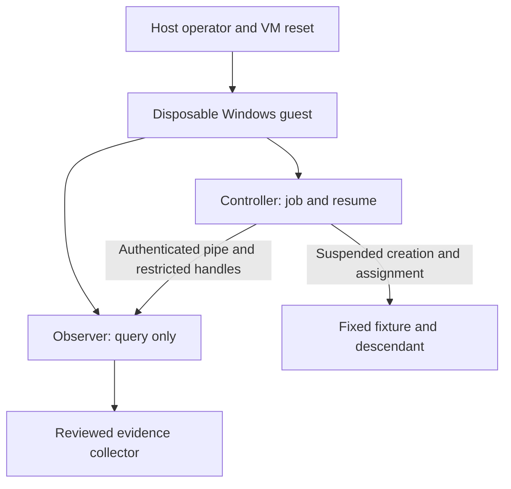

# R5.1 — Core local application integration

**R5.1: PARTIAL. R5: PARTIAL. Production: NO-GO.** The backend workflow below has focused synthetic evidence. The frontend changes have not been executed or type-checked, and the real local application has not been started. These limits prevent a scoped R5.1 PASS.

## Changes and contracts

- The planning SSE wrapper previously continued after an engine `error` and could emit `done`. It now terminates immediately and closes the engine stream. A production-route synthetic regression checks that neither subsequent text nor `done` is emitted.
- Starting a model inference check previously discarded the capability report, temporarily removing the default selection and inventory. The UI now retains the report while setting chat and planning to `unknown/inference_check_in_progress`; the server remains authoritative and the composer remains locked.
- The model selector now treats implicit and explicit Ollama `:latest` names as the same selected card. This makes the inference-check control available for a default configured without the tag when inventory includes it. Requests still use the actual selected identity and server readiness checks.
- An existing direct-route test passed `None` as a request, predating the readiness gate. Its fixture now supplies the application state expected by the production route; it does not disable readiness in production.

The authenticated opt-in development chat-only lifespan retains its existing configuration checks, cleanup stack, and unavailable protected-store placeholders; it does not initialize Chroma or embeddings. Inventory alone does not establish inference readiness. Explicit readiness is short-lived and tied to selected model, endpoint, configuration and available provider digest evidence. Chat checks it at request and stream start; it does not guarantee subsequent inference or atomic model identity. Provider failures and interruptions remain failures. The process-local receipt supports only eligible verified cross-turn results and is invalidated with conversation deletion or expiry.

The new ASGI route test creates a server-issued owned conversation, streams an ordinary response without tool execution, obtains verified calculator results **42 → 126 → 131**, runs the real permitted unit converter for **5 km → 5000 m**, renames and reads history, denies another owner, and deletes it. The provider and its tool-selection output are deterministic synthetic fixtures; this does not demonstrate live model planning or inference. Existing focused tests cover readiness checks and expiration, digest and endpoint changes, partial startup cleanup, provider cancellation/failure, ownership, authorization freshness and protected gates. Auth transitions, logout, stale UI streams and browser behavior were inspected but not execution-verified in this milestone.

The selected-model and checking-state UI fixes are static changes only. Text and image capability checks remain separate, and protected document and artifact operations, publication, generated-code execution and approval resume remain blocked. Artifact publication is not inferred from a tool response.

## Verification

From the repository root, using synthetic providers, temporary data, in-process ASGI and the existing socket-forbidding offline loop; no real services or sockets:

```powershell
$env:PYTEST_DISABLE_PLUGIN_AUTOLOAD='1'
python -m pytest -q tests/backend/test_r51_core_slice.py tests/backend/test_r13_lifecycle_readiness.py tests/backend/test_r12_readiness_offline.py tests/backend/test_a2_provider_offline.py tests/backend/test_a21_conversation_offline.py tests/backend/test_i112_numeric_receipts.py tests/backend/test_a33_production_tools_offline.py tests/backend/test_i81_authorization_freshness.py tests/backend/test_i1_document_gate_offline.py tests/backend/test_i101_artifact_boundary.py tests/backend/test_r41_shared_storage_gate.py
```

**87 passed, 1 warning in 15.55 s.** The warning was pytest's unknown `asyncio_mode` configuration with plugin autoload disabled. An earlier run of the same suite had **86 passed, 1 failed**, because the old direct-route fixture passed `None` instead of a request; the fixture was corrected as described above. During new-test development, the first runs exposed an incomplete fake provider and a fake that did not request conversion; those fixture defects were corrected before the final run. No timeout occurred.

The earlier automatic approval review rejected frontend build continuation because of possible registry access. No frontend harness, TypeScript, Vite, package manager, mounted React or browser test was run. Frontend readiness implementation, TypeScript, production build and browser are **NOT VERIFIED**. Live Ollama and application startup are **NOT VERIFIED**.

## Remaining release blockers

- **A — Confirmed code defects:** The three narrow defects above are fixed; their frontend portions still require execution verification. No claim is made that the rest of the application is defect-free.
- **B — Existing component integration:** Actual model tool-following and the complete frontend-to-backend interaction have not been demonstrated with real inference and a mounted UI.
- **C — Authorization/environment:** A separately approved isolated offline frontend dependency/build scope and a bounded live local runtime test are needed. Windows asyncio behavior and independently controlled process ownership/shutdown remain unresolved; the launcher stays disabled.
- **D — Protected storage/security:** Native broker identity, filesystem writer exclusion, external index freshness, recovery and authorization atomicity are unverified. Protected RAG, artifact writing and publication stay blocked; these are not prerequisites for a restricted chat-only demonstration.
- **E — Organizational deployment:** Multi-user operational security, deployment, recovery and independent assurance remain outside this milestone and exceed the requirements for a single-user local test.

Next prepare a separately authorized, isolated test with reviewed offline frontend dependencies, independently verified process ownership and cleanup, authenticated chat-only configuration, and an already installed local Ollama model. Run the frontend build and mounted-browser flow only within that approved scope, then test explicit model readiness, streamed chat and tool/history behavior against the real local runtime. Do not enable protected services as part of that test.

## R5.2 — Authorized local-runtime verification

**R5.2: BLOCKED. R5: PARTIAL. Production: NO-GO.** The requested prerequisites are not established for this workspace. No live test was attempted. The R5.2 request is conditional on independent environment and operation-specific authorization; it does not supply evidence of those prerequisites. No approval for the exact guest, process tree, loopback flows, browser, monitoring, hard timeout and cleanup was found in the inspected records. In particular, the earlier automatic review rejected frontend build continuation due to possible registry access. Separate explicit authorization for TypeScript, Vite/build and an approved offline environment remains required; no alternate invocation was attempted.

Read-only inspection found `frontend/node_modules` and `frontend/package-lock.json`. The lock contains transitive integrity information, but the installed tree and complete offline artifacts were not verified against it. `tools/offline_verification/i3_manifest.json` explicitly identifies itself as incomplete and unapproved; `requirements.txt` is not a complete Python artifact lock. The historical installed-distribution snapshot hashes metadata, not wheel artifacts. A reviewed complete dependency bundle, browser/DOM runner and model content identities are not established. No installation, dependency resolution, package manager, model download or executable version check was run.

The I5.4 lifecycle report states that an independently controlled native supervisor and executable native matrix are not complete. Owned process creation, descendant containment, listener identity, independent hard timeout, startup-failure cleanup, unrelated-process preservation and zero survivors remain unverified. The disabled launcher was not restored and no alternate startup path was used. The network audit does not establish effective per-process egress denial, and the existing monitoring foundation has unknown native coverage. Loopback-only settings are not independent isolation evidence. Ollama and browser networking, SSE behavior and actual bind ownership were not probed; the prior Windows asyncio socketpair stall remains unresolved.

| Evidence category | R5.2 result |
| --- | --- |
| Backend startup and shutdown | **NOT RUN** — containment, isolation and exact execution approval unavailable. |
| Live Ollama, inventory, readiness and inference | **NOT RUN** — endpoint, model identity, monitored isolation and operation-specific approval unverified. |
| TypeScript and production build | **NOT VERIFIED** — prior automatic review rejection remains in force; separate approval required. |
| Mounted React and real browser | **NOT VERIFIED** — approved runner, isolation and process cleanup unavailable. |
| Native process ownership and cleanup | **NOT VERIFIED** — no independently verified supervisor or native matrix. |
| Network isolation | **NOT VERIFIED** — no independent effective egress/monitor evidence for this environment. |
| Protected security gates | **NOT RE-TESTED LIVE** — unchanged by this report; R5.1's synthetic gate evidence is not live security verification. |
| Real chat, tools, history, cancellation and performance | **NOT RUN** — no real runtime or model evidence; no latency or memory claims. |

Only read-only inspection was performed in the existing managed Windows workspace, under the user's request: `Get-Content` for this report, the I3 offline-readiness report, the offline package report, frontend package manifest, I3 inventory and preflight source; `rg -n` over the lifecycle, frontend, R1 and egress reports; `rg --files` for verification-related paths; `Get-ChildItem frontend -Name -Force` filtered to dependency/lockfile names; and `git status --short -- RELEASE_R5_APPLICATION_INTEGRATION_REPORT.md`. The first egress-report lookup used an incorrect root path and returned file-not-found; the subsequent lookup used `docs/audit/phase1_5/TELEMETRY_AND_EGRESS_AUDIT.md`. These inspection commands required no test identity, did not connect to a service or start child test processes, and required no service cleanup; no test timeout was configured or triggered. No synthetic tests were substituted for live evidence.

Next implement and independently review an outer native supervisor with stable ownership, bounded output and cleanup observation, then obtain separate approval for its disposable native matrix and isolated network monitoring. Prepare a reviewed, hash-verified offline dependency/model bundle and exact browser/build/runtime commands. Only after the supervisor, isolation and operation-specific approvals pass should an operator perform the authenticated chat-only workflow with synthetic accounts and data. Protected document operations, artifacts and the launcher remain blocked. No security settings were changed and no commit, merge or push was made.

## R5.3 — Process lifecycle and native test boundary

**R5.3: PARTIAL. R5: PARTIAL. Production: NO-GO.** The experimental driver and coordinator have three narrow lifecycle fixes, verified with fake native calls only. The independent hard-timeout supervisor is not implemented or natively verified; the requested executable, reproducible native package therefore remains **BLOCKED**, not complete.

The existing driver creates each root suspended, records its process and thread handles, assigns it to a kill-on-close Job Object, verifies membership and resumes it. Job cleanup targets the retained job handle and, for an unassigned suspended root, its retained process handle; it does not terminate by PID or port. The listener resolver compares exact loopback table entries with held process identity including creation time, repeats the snapshot and checks job membership. Descendant listener identity, native API correctness and OS-level behavior are unverified. The driver deliberately reports health unavailable and is not connected to the disabled `scripts/dev.ps1` launcher.

Changes: (1) roots are checked for exit before and after resume so an exited child is not reported as started; (2) beginning cleanup permanently closes that job object to new roots and repeat cleanup calls, preventing an uncertain partial handle-close sequence from reusing potentially closed handles; the coordinator records cleanup uncertainty instead of success; (3) the coordinator checks all root processes before returning for a pending first listener, so it notices an exited sibling. Cleanup can still be uncertain and retained handles can remain open; no automatic retry or claim of physical cleanup was added. Listener mismatch and port collisions remain fail-closed. A held handle, not a stale PID, is the cleanup target; the handle model itself still needs native verification.

`RuntimeCoordinator` has a caller-polled startup deadline, **not an independent hard timeout**. `tools/process_test_supervisor/policy.py` is a fail-closed synthetic result policy, not a process runner, watchdog or bounded pipe collector. A blocked native call can prevent the coordinator from polling or cleaning up. No separate watchdog, independently verified containment or safe native cleanup mechanism was invented. No native process, listener, socket, app, Ollama, Chroma or VM was launched; no Windows policy was changed.

From repository root, synthetic native objects and process state only:

```powershell
$env:PYTEST_DISABLE_PLUGIN_AUTOLOAD='1'
python -m pytest -q tests/backend/test_i52_windows_job_mock.py tests/backend/test_i53_listener_mock.py tests/backend/test_i54_supervisor_policy.py tests/backend/test_i5_lifecycle_state.py
```

**41 passed, 1 warning in 0.89 s**; the warning is the unknown `asyncio_mode` option with plugin autoload disabled. No timeout occurred and no external test timeout was configured. Tests include assignment and membership failures, root exit, cleanup uncertainty, repeated stop, synthetic descendant survival, listener/creation-time mismatches, port ambiguity and timeout classification. They do not establish native containment, independent timeout enforcement or unrelated-process survival. `git diff --check` for the four modified source/test files completed without output.

### Native verification package — blocked pending independent supervisor

The initial candidate uses the existing `tests/fixtures/i52_processes/synthetic_tree.py` with no `--listen` option, disposable root/children only, and no application or model. The prior inspected environment recorded 64-bit Windows and CPython 3.13.7 (`C:\Python313\python.exe`); these are historical observations, not verified target prerequisites. The operator must select an approved Windows version/architecture and least-privilege account, independently verify exact interpreter, fixture, supervisor binary, transitive dependencies and hashes, and approve the exact commands, synthetic process tree, output limits and evidence destination. No supervisor executable or independently verified external watchdog exists to specify a safe runnable command today. The fixture has a 20-second sleep but that is **not** an external timeout. Do not invoke it directly as a substitute.

After an independently reviewed outer supervisor exists, the approved operator must establish containment before child execution, retain stable handles and record creation identity and job membership. The independent watchdog must impose an approved hard deadline, own a separate safe cleanup mechanism, capture bounded output, handle its own interruption and prove zero owned survivors while an independently identified unrelated control remains alive. Exercise assignment/resume failure, early root/child exit, descendants, timeout and repeated cleanup; failure or unknown ownership/cleanup is FAIL or BLOCKED, never PASS. Verify nested-job compatibility before testing the inner job and do not weaken containment on conflict. Record exit status, deadlines, API errors, identities, membership and independently observed cleanup; stop and preserve evidence on uncertainty. Listener checks require a **separate later approval** for isolated loopback: correlate exact IPv4/IPv6 listener snapshots and creation-time identity, test collision/replacement and preserve unrelated listeners. No sockets are part of the initial non-networked process test.

Required next action: implement and independently review a real outer supervisor and its independent watchdog/cleanup boundary, including bounded pipe collection and interruption semantics; obtain operation-specific approval for an isolated Windows environment and reviewed binary/fixture set before any disposable process test. Then generate exact versioned commands and run the native matrix under that independent boundary. Until those conditions are met, the native verification package and actual process ownership, listener identity, timeout and cleanup remain unverified. The prior frontend build restriction remains in force; no install, commit, merge or push occurred.

## R5.4 — Independent watchdog boundary

**R5.4: PARTIAL. R5: PARTIAL. Production: NO-GO.** A real independently controlled watchdog and runnable native verification package are **not implemented**. The existing `RuntimeCoordinator` uses a caller-polled deadline and can stall inside driver calls; `tools/process_test_supervisor/policy.py` classifies synthetic observations and cannot start, watch or terminate a process. Neither provides an independent hard timeout. The Job Object driver keeps job/root/thread handles inside the supervised process; no reviewed secure handle-transfer mechanism or separately owned cleanup authority exists. A separate source module or injected fake would not establish independence.

One concrete lifecycle defect was corrected in the existing coordinator: if startup or readiness is interrupted and cleanup itself is also interrupted, the original interruption now propagates and state remains `CLEANUP_UNVERIFIED`. Previously the cleanup interruption masked the original. This does not provide a watchdog or verify cleanup. Existing process and job handles, suspended assignment, listener identity checks and no-PID-only termination remain unchanged. Timeout, termination request, actual termination and cleanup cannot yet be independently observed or guaranteed by an external component.

Safe completion requires a reviewed design and implementation for a separate watchdog that receives or creates verifiably owned, appropriately scoped native handles before the supervised operation runs, authenticates a bounded operation handshake, uses its own monotonic deadline, requests termination through those handles and separately verifies root and descendant exit. Its startup, communication failure, shutdown, nested-job behavior and cleanup must be bounded by an **independently controlled outer supervisor**. Existing kill-on-close semantics and a timeout alone are not proof of these guarantees. An independently approved disposable Windows environment and operation-specific authority are necessary to verify them. The first native test must use non-networked synthetic workloads and an unrelated control, never the real application.

From repository root, using fake native/process abstractions only:

```powershell
$env:PYTEST_DISABLE_PLUGIN_AUTOLOAD='1'
python -m pytest -q tests/backend/test_i52_windows_job_mock.py tests/backend/test_i53_listener_mock.py tests/backend/test_i54_supervisor_policy.py tests/backend/test_i5_lifecycle_state.py
```

**43 passed, 1 warning in 0.87 s**; warning: pytest's unknown `asyncio_mode` with plugin autoload disabled. New tests inject simultaneous primary and cleanup interruptions during startup and readiness; they assert preservation of the original exception, uncertain cleanup and no retry. Existing synthetic tests cover assignment, identity, listener and descendant cases. No external timeout was configured or triggered and no native processes, sockets or Windows APIs were exercised.

The R5.3 proposed non-networked fixture and native matrix remain **not runnable as an authorized package**: there is no watchdog executable, independently reviewed outer supervisor, approved environment, verified handle/cleanup boundary, exact executable set or operation-specific command. Do not execute the fixture directly or infer safety from synthetic tests. Next implement and independently review the handle-ownership and watchdog boundary together with an outer containment mechanism, then prepare exact hashed executables, bounded commands and evidence/cleanup criteria for explicit isolated-environment approval. No real service, native test, VM, package install, frontend build, security-policy change, commit, merge or push occurred. The launcher remains disabled.

## R5.5 — External fixture-controller ownership

**R5.5: PARTIAL. R5: PARTIAL. Production: NO-GO.** Added an experimental fixture controller that can hold the existing Job Object and process handles outside the supervised workload, if invoked from a separately controlled process. This is not yet an independently bounded controller process, a launcher, a runnable native package or native verification.

`tools/process_test_supervisor/outer_controller.py` selects outer ownership rather than passing numeric handle values between processes. Its default factory fixes the workload to the current Python executable and existing synthetic non-networked root/child fixture; it accepts no client PID, kill path or command. The controller creates a server-side operation ID, opens the existing `WindowsJobDriver` containment and calls `start_contained`, which creates suspended, assigns and verifies job membership before resume. It then waits on the retained root handle with a bounded Windows `WaitForSingleObject` interval, using a monotonic deadline, and invokes the existing handle-based cleanup. The new `wait_root` rejects foreign roots/jobs and invalid waits. No IPC, executable entry point or application integration was added.

The returned operation outcome distinguishes observed root exit, deadline, unverified wait and failure from the cleanup result. Cleanup is `observed` only if the existing driver reports its job and retained roots inactive and closes its handles; otherwise it is `uncertain`. This is the driver's own observation, not independent evidence. One controller instance is single-use. Existing listener identity and coordinator rules remain unchanged; there is **no coordinator-to-controller integration** or authentication protocol. The synthetic controller's outcome is not a production lifecycle authority.

Structural limits are material: the caller must actually launch the controller as a separate process, but this module neither launches itself nor authenticates that relationship. Creation, assignment, resume, native wait and cleanup calls can stall in the controller; the deadline cannot interrupt a blocked call and may expire during startup before the controller regains control. The driver's cleanup makes only one nonblocking active-process observation, so normal asynchronous termination may produce `uncertain`. Controller crash/hang, unrelated-process survival, descendants, process exit status and stable native identities require independent observation. A reviewed outer supervisor or approved disposable environment remains necessary to bound and clean up the controller itself. Kill-on-close is not evidence of completed cleanup.

From repository root with fake native objects only:

```powershell
$env:PYTEST_DISABLE_PLUGIN_AUTOLOAD='1'
python -m pytest -q tests/backend/test_r55_outer_controller.py tests/backend/test_i52_windows_job_mock.py tests/backend/test_i53_listener_mock.py tests/backend/test_i54_supervisor_policy.py tests/backend/test_i5_lifecycle_state.py
```

**54 passed, 1 warning in 1.04 s**; warning: unknown pytest `asyncio_mode` with plugin autoload disabled. The new tests exercise retained-handle waits, synthetic timeout, root signal, assignment/resume/wait/termination failure, a surviving fake descendant, unrelated fake process, foreign handles, pre-start deadline and interruption cleanup. They do not create processes, sockets or Windows objects; no external timeout was configured or triggered. `git diff --check -- backend/runtime/windows_job_driver.py` completed without output.

The R5.3 native package remains **BLOCKED**: no independently reviewed outer supervisor, executable test entry point, binary/dependency hashes, trusted cleanup observation or approved Windows environment is available. The fixed fixture and controller are source inputs for review, not a runnable approved test command. Before testing, complete and review an independently controlled outer runner, bounded output and cleanup, explicit controller failure/disconnection handling, process exit evidence, nested-job handling and coordinator integration; then specify exact hashed executables, test commands, deadlines and expected exit codes for separately approved isolated Windows tests. No application, native process test, Ollama, Chroma or VM was started. No launcher, host policy, dependencies or protected capability was changed; no commit, merge or push occurred.

### R5.5 completion attempt — pre-resume deadline

**R5.5 implementation: PARTIAL. Native verification: BLOCKED. R5: PARTIAL. Production: NO-GO.** The separate-process boundary requested here is not complete. No executable helper or coordinator integration was added: the missing interface is a reviewed outer authority that creates and identifies the helper, holds a valid independent cleanup authority over its entire process tree, bounds helper startup and IPC, and independently observes cleanup. The current synchronous controller alone cannot enforce a deadline while blocked in a native call. Starting it in another process without that authority would not satisfy the requested boundary or make an executable test package safe.

The controller's intended ownership remains local to the controller process: it creates the job and retained process handles via the existing driver, which assigns the suspended child before resume. It uses a bounded root-handle wait after startup and requests handle-based termination through the driver; it does not use PIDs as termination authority. Its cleanup result is the driver's observation, not independent native evidence. If the controller or coordinator crashes, actual cleanup depends on unverified Job Object/handle behavior and an independently controlled outer environment. No authenticated helper handshake, external process launcher, IPC, independent termination authority or application-coordinator adapter exists. The existing coordinator and disabled launcher were not connected to synthetic observations.

One concrete startup defect was fixed: the deadline was checked before and after `start_contained`, but not between assignment and resume, so a child could start after a slow assignment exceeded the deadline. `start_contained` now supports an optional pre-resume guard; the fixture controller checks its monotonic deadline there. A failed guard leaves the child suspended and runs existing containment cleanup. This does not interrupt a stalled assignment, wait or cleanup and does not prove a native hard timeout. A synthetic guard failure is never treated as permission to resume.

From repository root, fake native/process objects only:

```powershell
$env:PYTEST_DISABLE_PLUGIN_AUTOLOAD='1'
python -m pytest -q tests/backend/test_r55_outer_controller.py tests/backend/test_i52_windows_job_mock.py tests/backend/test_i53_listener_mock.py tests/backend/test_i54_supervisor_policy.py tests/backend/test_i5_lifecycle_state.py
```

**56 passed, 1 warning in 1.05 s**; warning: pytest's unknown `asyncio_mode` option with plugin autoload disabled. New tests cover a deadline reached during assignment and a rejected pre-resume guard, including cleanup. Existing fake tests cover ownership mismatch, assignment/resume failure, timeout classification, uncertain descendant cleanup, listener identity and repeated shutdown. No native API, process, network service or external hard timeout was used; native execution and browser/build verification remain unverified.

The existing fixture can describe non-networked root/child, early exit and bounded stall, but it does not provide a separately controlled unrelated-process check, a reviewed external watchdog or independent cleanup evidence. Consequently there is **no safe runnable native verification package or exact approved command** yet. The next required action is to implement and independently review that external authority and helper/coordinator contract, including bounded IPC, retained job/process identity, failure recovery and independently observed no-survivor evidence. After a reviewed executable set and exact commands exist, an operator must separately approve the isolated Windows environment and disposable native test. No launcher, application, Ollama, Chroma, VM, policy or protected capability was changed; no dependency downloaded and no commit, merge or push made.

### R5.5 — External execution decision and operator handoff

**Decision: an operator-controlled, disposable, network-isolated Windows VM with host-side stop/reset authority.** This is a proposed authority, not an existing approved environment. The VM operator owns the outer boundary, verifies guest identity and a clean snapshot, records a host-side deadline, and can stop/reset the entire disposable VM if the guest controller or cleanup stalls. The operator must independently verify reset control and isolation before the test. Only guest processes and synthetic guest data are in scope; the hypervisor action must target the verified VM identity, never host processes. If the outer authority fails or VM identity is ambiguous, stop and classify the test **BLOCKED / cleanup unknown**. VM reset restores a disposable environment; it does not demonstrate orderly Windows Job Object cleanup, descendant termination, or preservation of an unrelated guest process. Capture evidence before any reset.

**Ownership:** `WindowsJobDriver.open_containment` creates the job in the calling controller; `start_contained` creates suspended roots, retains process/thread handles, assigns and checks membership before resume; `wait_root` observes a retained root handle; `stop_containment` requests termination via the retained job or, for an unassigned root, its retained process handle and checks job/root state. `OuterController.run` holds the driver and deadline in that same controller process. `RuntimeCoordinator` is a separate in-process contract and has no controller IPC integration; the listener resolver compares held identities, including creation times, but is outside this initial non-networked test. No cleanup uses PID alone. The guest controller owns its native handles; the host VM operator owns reset authority, not those handles.

If a workload hangs, the controller's bounded root wait can reach its deadline and request job cleanup, subject to native verification. If the controller hangs in an API call or cleanup, its deadline cannot interrupt the call; the VM operator stops/resets the guest at the external deadline and records cleanup as unknown. Unexpected controller exit may close its handles and invoke kill-on-close, but descendant termination must be independently observed, not assumed. Coordinator communication loss is unsupported: there is no controller/coordinator channel; any future loss must fail closed. If the deadline expires before resume, the existing guard prevents resume once control reaches it; a stalled call still needs the external deadline. No component is assumed capable of recovering from its own hang.

**Code versus environment:** Outer-owned job handles are a plausible architecture inside the VM and do not require serialized handle transfer, but native behavior and nesting remain unverified. Before the first meaningful disposable test, code still needs a reviewed fixed-scope test entry point, a strictly non-network-capable fixture, selectable normal/stall/descendant cases, bounded evidence capture, job/root/descendant identity and termination evidence, independently observed unrelated-control preservation, and failure-injection hooks with explicit exit codes. Current fixture imports `socket` and supports `--listen`; omitting that flag does not meet the requested strict non-network-capable-workload requirement. Its controller has only a fixed root/one-child invocation, no test entry point, no independent observer and no output protocol. Coordinator integration and authenticated communication remain required before application use, but are not prerequisites for testing a disposable controller in isolation. The absent approved VM, reviewed offline artifacts and operator authority are separate environmental blockers. No source change was justified by this decision-only task.

**Operator authorization package — proposal, not executable or approved:**

- Environment: independently reviewed disposable 64-bit Windows VM, with no production data or credentials, no host shares, independently verified no external adapters/egress or host channels, and a host operator with verified stop/reset and snapshot restoration. Historical Windows `10.0.26300.0` and CPython 3.13.7 are observations, not approved version requirements; select and record supported exact Windows build, architecture, edition and Python patch version before approval. Use a least-privileged guest test account able to create and query its own disposable processes and Job Objects; separately review any extra rights required for the independent guest observer. Do not grant broad process-termination privileges as a workaround.
- Candidate inputs already present: `C:\Python313\python.exe` (historical/current observed SHA-256 `d932e5e2f324d57f392e8fd063dcf6d0185be8a664c57c6d24e7762ed02c28ca`), `tests/fixtures/i52_processes/synthetic_tree.py` (`f45bb837db921d55ca5fcc25588596af892272167b771288c14b946cbbc4b2db`), `tools/process_test_supervisor/outer_controller.py` (`7cd04427217196e5f52eb7939c7d7257bd132bc96754b5ed5f818fcc27787b12`), and `backend/runtime/windows_job_driver.py` (`2ba85c00c5225c929d2b0bb599673b26ca8d064cb88d6216eda1cc510b7f499f`). These read-only workspace hashes identify only those files at inspection time; they do not verify the Python runtime, complete import closure, dependency provenance, test entry point, guest copies or future versions. Independently review and pin the full Python standard library/native DLLs, all imported source, fixture, observer, executables and hashes in the actual guest. No installation or download is authorized by this report.
- Process scope: only an explicitly reviewed guest controller, non-network-capable synthetic child and at most one disposable descendant, plus a separately identified unrelated guest control. The current code cannot run this exact package: the missing entry point, strict fixture, observer and injection mechanisms above must be supplied and reviewed first. Exact full commands, fixture paths, executable hashes, expected exit codes and approved deadlines therefore **cannot yet be specified honestly**; no placeholder command is authorized. The existing I5 matrix is a scenario/evidence plan, not a runnable package.
- Required cases: normal root exit; child stall with controller deadline and distinct termination request/observed exit; descendant alive at timeout with independently observed zero owned survivors; controller hang and cleanup hang with host deadline/reset; assignment failure and deadline before resume with no child code executed; unrelated guest control surviving ordinary cleanup; and identity/creation-time mismatch rejection. Observe job assignment before resume, retained process identity, job membership and active-process counts with an independent guest observer. Record monotonic timestamps, bounded logs, native return categories and exit codes, process creation identities and observer health. No listener, application, model, Chroma or frontend operation is in scope.
- **PASS** only when the approved scenario's native evidence demonstrates pre-resume containment, correct operation/exit and independently observed cleanup with unrelated control intact, within both deadlines. A timeout-injection case passes only when timeout and verified cleanup are both observed; the controller reporting timeout is insufficient. **FAIL** for mismatched identity, unexpected execution, surviving owned process after claimed cleanup, unrelated-control harm, unexpected networking or a violated deadline. **BLOCKED** for missing approval, unreliable observer, unavailable cleanup authority, ambiguous identity, missing evidence, or VM reset without prior cleanup proof. Preserve sanitized evidence before restoring the approved clean snapshot; a reset is containment recovery, not a pass.

**First native test gate:** approve the exact isolated VM and independently verified stop/reset; verify VM identity, snapshot, egress controls and no host-process risk; review full executable/dependency hashes and fixed non-networked workload; approve exact process creation, observer, failure injections, deadlines, evidence destination and cleanup/reset commands; and verify operator/observer readiness. Any missing item blocks execution. The next operator action is to designate and independently review the disposable VM and host reset authority, then commission the missing fixed-scope test entry point and observer before approving exact commands. No VM, native test, real service, build or process workload was started during this inspection; no tests were rerun. No commit, merge or push was made.

### R5.5 — Fixed-scope fixture package work

**R5.5 verification-package implementation: PARTIAL. Native verification: BLOCKED. Production: NO-GO.** Added a fixed-scenario entry point and disposable fixture, but no genuinely independent observer, coordinator integration, approved host boundary or complete reviewable native evidence package exists. No native process test was executed.

`tools/process_test_supervisor/native_fixture_entry.py` accepts only `normal`, `stall`, `descendant`, `early_exit`, and `reject_containment`; arbitrary command, PID, path and network arguments are rejected. It generates an operation ID through the existing controller, uses a fixed five-second controller deadline and emits bounded categorical JSON containing the controller's claim. Exit **3 / EVIDENCE_INCOMPLETE** is always used for a returned controller result, including its own `cleanup=observed`; exit **2 / STARTUP_FAILED** indicates entry/initialization failure or argument rejection. No exit code represents native PASS. Abnormal interruption, broken output or host reset cannot be interpreted as success. This entry point is test-only and is not connected to application startup. Its proposed isolated-VM invocation shape is `python -m tools.process_test_supervisor.native_fixture_entry --scenario normal`; it is **not approved and was not run**. No command is ready for actual native verification without an independent observer and approved external containment.

`tests/fixtures/i52_processes/non_network_workload.py` has no network imports or network operations. It accepts only the fixed scenario and canonical operation UUID; normal exits after one second, early exit returns immediately, stall sleeps for 60 seconds, and descendant starts one copy of the same fixture with a fixed child scenario. `reject_containment` is a controller-side pre-resume rejection, **not** a native assignment-failure injection. The early-exit fixture is not proof of a deterministic pre-resume exit. The scenario is launched through the current interpreter with `-I -B`; the fixture cannot select another command or destination. Source inspection is not proof of OS network isolation. Runtime, DLLs, environment and all imported standard-library modules still require independent offline review.

The controller still owns the job and root handles; the entry output is a **claim**, not independent process identity, pre-resume membership, root exit status, descendant cleanup or unrelated-process evidence. `WindowsListenerAPI` can query process creation time from a held process handle, but the existing implementation does not give an independent observer a verified job handle, trustworthy controller/root identities, retained handles before resume, a safe identity-bound discovery channel, or independent descendant membership and exit observations. A controller-supplied PID or `success` flag cannot fill this gap. No observer was fabricated or claimed. The production `RuntimeCoordinator` is not exercised by this entry point and remains unintegrated; its synthetic tests do not establish integration. The VM host operator remains the independent stop/reset authority, and reset is not cleanup proof.

Review manifest: Python source only, no .NET build or binary hashes: `tools/process_test_supervisor/native_fixture_entry.py`, `tools/process_test_supervisor/outer_controller.py`, `backend/runtime/windows_job_driver.py`, `backend/runtime/lifecycle.py` (existing separate coordinator), `tests/fixtures/i52_processes/non_network_workload.py`, and `tests/backend/test_r55_native_package.py`; include the reviewed Python interpreter, full standard library/native DLLs and transitive source in any later independently hashed package. Windows build/architecture, exact interpreter, observer, host deadlines, evidence destination, failure-injection mechanism and binary/source hashes must be fixed by the approved operator environment. No .NET dependency was introduced and no build command was executed. Host reset and pre-reset evidence retention remain mandatory; reset alone is BLOCKED, not PASS. The existing R5.5 operator matrix defines other PASS/FAIL/BLOCKED criteria.

From repository root, static validation and fake objects only:

```powershell
$env:PYTEST_DISABLE_PLUGIN_AUTOLOAD='1'
python -m pytest -q tests/backend/test_r55_native_package.py tests/backend/test_r55_outer_controller.py tests/backend/test_i52_windows_job_mock.py tests/backend/test_i53_listener_mock.py tests/backend/test_i54_supervisor_policy.py tests/backend/test_i5_lifecycle_state.py
```

**69 passed, 1 warning in 1.23 s**, zero skips; warning: pytest's unknown `asyncio_mode` with plugin autoload disabled. No real native API, process fixture, listener, VM or service was used, and no external test timeout was configured or triggered. Tests check allowed inputs, result projection, non-network imports, fixed script/operation identity and existing synthetic lifecycle cases, not Windows enforcement.

Next operator action: designate and independently review the isolated Windows VM and host stop/reset authority, then commission a reviewed independent observer and identity/job-handle evidence channel plus coordinator integration. Pin and review the exact offline runtime and source hashes, observer permissions, scenario commands, evidence retention and outer deadline before separately authorizing any native test. No binary was built, no dependency downloaded, no host security setting altered, and no application launcher, commit, merge or push was made.

### R5.5 — Local handle observation foundation

**R5.5: PARTIAL. Native verification: BLOCKED. Production: NO-GO.** Added a read-only, single-process-handle observer in `tools/process_test_supervisor/process_observer.py`. It accepts a canonical operation UUID, fixed scenario, borrowed handle and expected `(PID, creation time)`, queries identity before and after a zero-time liveness observation, and emits a versioned record containing the binding, local monotonic timestamp, identity, running/exited/unknown state and categorical error. Missing handles, failed APIs, changed creation times, invalid or mismatched identity cannot establish a positive observation. No handles are opened, duplicated, closed or terminated by this module. The default Windows adapter reuses `WindowsListenerAPI.process_identity` (`GetProcessId`, `GetProcessTimes`) and `WindowsNativeAPI.running` (`WaitForSingleObject`). A handle must already be valid in the observer process with appropriate query and synchronization rights; exact permissions and behavior remain natively unverified.

The record labels its provenance `local_handle_query_unverified`: it is not authenticated and a caller-supplied expected identity does not establish fixture ownership. A process signal is a snapshot of one process, not independent proof of termination cause, descendants, job membership, containment before resume, current authorization, or complete cleanup. No parent/executable identity is established. An expected PID with a different creation time fails closed; PID alone is not evidence. No proof of cryptographic identity, cross-process transfer, clock synchronization or independent observation is claimed.

The existing `IsProcessInJob` adapter can query a process against a job handle in its own process, but the separate observer has no verified way to acquire or identify the *correct* job and process handles. A numeric handle in a message is not transferable. A reviewed process-creation/inheritance or `DuplicateHandle` mechanism with source and target process identity, access rights, handle lifetime, pre-resume synchronization and independently authenticated evidence transport is still required. `QueryInformationJobObject` and independent root/descendant discovery and exit observations also require that verified boundary. Observer outage, missing evidence, stale or unbound identity and host reset must remain incomplete; a controller-reported success does not substitute for them.

The fixed entry point now explicitly reports `observer_evidence: null` and still returns **3 / EVIDENCE_INCOMPLETE** for controller results. This does not connect the observer to the controller or coordinator. `RuntimeCoordinator` is unchanged, the launcher remains disabled, and no controller result, observer record or VM reset grants readiness. A complete ordered, scenario/operation-bound evidence stream, duplicate/finalization and contradiction handling, observer process authentication, job/descendant evidence, coordinator integration and independent guest observation remain unimplemented. R5.5 cannot pass for an isolated helper or fake-API evidence alone.

Updated review manifest adds `tools/process_test_supervisor/process_observer.py` and `tests/backend/test_r55_process_observer.py` to the preceding source list. Python/Windows API sources only; no compiled observer or binary hash exists, and no .NET version is required by this addition. Before any authorized native run, pin the complete Windows build/architecture and runtime hashes, review the native API/handle permissions, provision independent handle acquisition and evidence retention, and verify the VM operator's external deadline/reset and unrelated-process control. No host reset may be counted as guest cleanup. Existing fixed-scenario entry exit codes and the R5.5 operator PASS/FAIL/BLOCKED matrix remain in force.

From repository root with injected fake APIs only:

```powershell
$env:PYTEST_DISABLE_PLUGIN_AUTOLOAD='1'
python -m pytest -q tests/backend/test_r55_process_observer.py tests/backend/test_r55_native_package.py tests/backend/test_r55_outer_controller.py tests/backend/test_i52_windows_job_mock.py tests/backend/test_i53_listener_mock.py tests/backend/test_i54_supervisor_policy.py tests/backend/test_i5_lifecycle_state.py
```

**80 passed, 1 warning in 1.57 s**, zero skips. Warning: unknown pytest `asyncio_mode` with plugin autoload disabled. Tests cover binding validation, simulated PID reuse, identity change, missing handle/API, running versus exited, and previous synthetic controller/lifecycle gates. They do not validate real Windows APIs, cross-process observation or independent containment. No native process, workload, socket, VM, service or external timeout was used.

Next operator action: designate and review the disposable Windows VM and host stop/reset authority; commission review of an identity-bound observer handle-acquisition and pre-resume evidence channel before authorizing exact disposable-process commands. No native binary, dependency, host security setting, application, commit, merge or push was created or changed.

### R5.5 — Pre-resume evidence gate

**R5.5: PARTIAL. Native verification: BLOCKED. Production: NO-GO.** The fixed-scenario entry point previously instantiated and ran its controller despite lacking an independent observer, then reported evidence incomplete after execution. It now returns **3 / EVIDENCE_INCOMPLETE, observer_handoff_unavailable** before constructing a controller or creating a child. There is no input, flag or fake acknowledgement that unlocks this entry point. This is a fail-closed gate, not an implemented observer handshake. Direct invocation of the experimental `OuterController` is not guarded by this entry point and is not approved for native execution. The application launcher remains disabled.

**Proposed handle-acquisition direction, not implemented or reviewed:** transfer restricted process and job handles with documented Windows handle duplication into a separately identified observer process, retaining explicit lifetimes. Review must establish the source and target process identities and creation times using held handles, appropriate duplication authority and minimum observer query/synchronization rights, and bind the exact job, process, fixture executable identity, scenario and operation to a protected channel. Numeric handle values are meaningful only inside the receiving process after successful native duplication. The current controller owns an unnamed job and process handle; it exposes no authenticated observer connection, executable identity check, correctly duplicated handle, independently validated job identity or evidence acknowledgement. Therefore neither inheritance nor duplication currently provides an independently reviewable binding, and no transfer implementation or permissive fallback was added.

The existing `before_resume` guard verifies only deadline and the synthetic rejection scenario; it is not an independent containment acknowledgement. A real protocol must obtain observer-owned valid handles after suspended creation and assignment, independently check the exact process and intended job, bind a fresh acknowledgement to operation/scenario/fixture/process creation identity and deadline, and permit resume only after that acknowledgement. Job membership at observation time is not independently established as pre-resume until the timing/synchronization channel itself is trustworthy. The entry is blocked before any of this occurs. `RuntimeCoordinator` remains unintegrated; no synthetic record, controller result or host reset can unlock the application.

The existing driver separately queries root liveness and job active-process count during cleanup. Root exit, a successful termination request, a single count, and handle closure are not independent descendant cleanup proof. No new descendant enumeration, cross-process membership observation, executable identity, cleanup verification or native evidence channel was claimed. The proposed disposable VM still requires separately approved host stop/reset, network isolation, pinned binary/dependency hashes, observer permissions, evidence retention and operation-specific authorization. No VM, workload, process, network listener or service was started.

From repository root with fake Windows APIs and static checks:

```powershell
$env:PYTEST_DISABLE_PLUGIN_AUTOLOAD='1'
python -m pytest -q tests/backend/test_r55_process_observer.py tests/backend/test_r55_native_package.py tests/backend/test_r55_outer_controller.py tests/backend/test_i52_windows_job_mock.py tests/backend/test_i53_listener_mock.py tests/backend/test_i54_supervisor_policy.py tests/backend/test_i5_lifecycle_state.py
```

**79 passed, 1 warning in 1.59 s**, zero skips; warning: pytest's unknown `asyncio_mode` configuration with plugin autoload disabled. The entry tests verify all fixed scenarios fail before controller construction, reject extra arguments and expose no observer claim. The count changed from 80 because a prior test for a now-unreachable entry startup-error branch was removed. Existing fake tests cover deadline, process identity mismatch, assignment, cleanup uncertainty, listener mismatch and lifecycle behavior. They do not test `DuplicateHandle`, a native observer handshake or real descendant cleanup. No external timeout was configured or triggered.

Next operator action: designate and independently review the disposable VM and host reset authority, and commission review of the specific duplicate-handle, observer-identity and pre-resume acknowledgement design before authorizing any native test. No dependency, binary, host security setting, application, commit, merge or push was created or changed.

### R5.5 — Final integration gate: outcome B

**Implementation: PARTIAL. Native verification: BLOCKED. Production: NO-GO.** The requested identity-bound handoff cannot be completed safely within the current ownership architecture. This is a specific missing implementation and independent-execution boundary, **not** evidence that Windows lacks `DuplicateHandle` or that a suitable API is impossible. No speculative observer, handoff or unrelated source fix was added.

The selected candidate is controlled `DuplicateHandle` into a separately created and identified observer, with restricted process-query/synchronization and job-query access; the exact rights, duplication authority and handle lifecycle require independent Windows API/security review. The source and receiving process identities must be established via retained process handles and creation times, not numeric handles or caller-supplied PIDs. The observer must receive actual handles valid in its own process and bind the observed process, fixture executable identity, job, scenario, operation and fresh deadline to an authenticated channel. A duplicated handle is not itself proof that the operation or fixture is correct. No such observer process, target-process handle, secure channel, process creation protocol or duplication mechanism exists in `tools/process_test_supervisor/outer_controller.py` or `process_observer.py`; the latter only accepts a borrowed handle already valid in its own process and caller-supplied expected identity. Creating a fake acknowledgement would not fix that missing authority.

In `backend/runtime/windows_job_driver.py`, `start_contained` retains job, root and thread handles locally, assigns the suspended child and invokes the optional `before_resume` callback. In `OuterController.run`, that callback checks only deadline and the synthetic rejection case; it has no independent observer acknowledgement. It cannot currently bind observer identity, fixture identity or the correct job to the operation. `native_fixture_entry.py` consequently returns `EVIDENCE_INCOMPLETE` before controller creation. Direct controller invocation is **outside the approved test scope**. `RuntimeCoordinator` has no controller/observer evidence interface and its default driver remains unavailable; the real launcher stays disabled. No pre-resume independent membership claim or coordinator integration is implemented.

`stop_containment` requests termination and checks a controller-local active-process count and root handles once. The observer has no independently acquired handle to the exact job, no verified process discovery, and no complete descendant enumeration or exit channel. Thus root exit, termination request, a local count of zero, handle closure and VM reset cannot individually establish independently verified descendant cleanup. Required future evidence includes an observer-owned query handle to the correctly identified job, independently bound retained root/descendant identities, observed job accounting and exit states, and an authenticated ordering/evidence protocol; the exact API rights and completeness limitations must be reviewed before implementation and native tests. No guarantee about external processes is inferred from job accounting.

**Operator handoff:** choose and independently review a disposable 64-bit Windows VM with a host operator who can identify and stop/reset that exact VM under an external deadline. Independently verify isolation, no host shares or production data, and a safe evidence-retention path before reset. Review and pin exact Windows build, Python runtime, fixture, controller and observer binaries/source and their full dependencies; no observer executable or compiled hash exists yet. Approve only fixed non-networked normal, stall, descendant and rejection scenarios, their exact commands, identities, Windows API permissions, timeouts and guest observer evidence. Verify unrelated guest-control identity and survival. Require separate operation-specific approval before any process creation. **PASS** requires independently observed pre-resume binding and guest cleanup with no owned survivors and unrelated control intact; **FAIL** covers wrong identity, uncontained execution or surviving claimed-clean processes; **INCONCLUSIVE/BLOCKED** covers absent authority, rights, evidence, observer failure, or VM reset without prior cleanup proof. No VM was provisioned or started.

Read-only inspection located the missing boundaries in the files named above. A broad `rg` command used Windows-incompatible wildcard operands for two test paths and reported those paths as invalid; the relevant test files were read directly. From repository root, the permitted focused offline regression command was:

```powershell
$env:PYTEST_DISABLE_PLUGIN_AUTOLOAD='1'
python -m pytest -q tests/backend/test_r55_process_observer.py tests/backend/test_r55_native_package.py tests/backend/test_r55_outer_controller.py tests/backend/test_i52_windows_job_mock.py tests/backend/test_i53_listener_mock.py tests/backend/test_i5_lifecycle_state.py
```

**64 passed, 1 warning in 1.36 s**, zero skips; warning: unknown pytest `asyncio_mode` with plugin autoload disabled. These tests cover only fake native handles and current fail-closed behavior; there is no handoff implementation to test and they do not demonstrate actual Windows containment. No native process, fixture, service, VM or external timeout was used.

**One next action:** have a Windows security engineer and the prospective VM operator jointly review and approve the separate observer identity, restricted handle-duplication and pre-resume acknowledgement design—including an independently bounded host reset and evidence channel—before commissioning implementation or authorizing a disposable native test. No launcher, security policy, dependency, commit, merge or push was changed.

### R5.5 — Windows native verification design review

**Decision: REVISION REQUIRED. VM approval: BLOCKED. R5.5: PARTIAL; native verification: BLOCKED; production: NO-GO.** The proposed handle duplication is a viable Windows mechanism in principle, but the current architecture does not establish an independent observer, protected identity-bound IPC, pre-resume acknowledgement, or independent cleanup evidence. The fixed entry still returns `EVIDENCE_INCOMPLETE` before controller creation. This review is not an approval to execute, and no application behavior or supervisor code was changed.

**Proposed ownership, not yet accepted for implementation:** the experimental controller creates a dedicated fixed-purpose observer with `CreateProcessW`, retains its real process handle and verifies its PID, creation time, approved executable identity and expected Windows token/account through reviewed OS calls before any handoff. The observer is a separate process and must not accept arbitrary PIDs, commands or handle requests. A private, bounded, access-controlled channel established during controlled creation must bind the retained peer identity, per-run unpredictable operation nonce and scenario; a same-account SID or a claimed PID alone is insufficient. Review the exact IPC peer identity, handle inheritance list and token rights rather than assuming a pipe connection authenticates its peer. The controller remains the only process with workload resume and job termination authority; the observer receives query-only authority and cannot independently launch or terminate processes.

**Handle transfer and rights:** the controller owns the unnamed job, suspended fixture process and primary thread handles. After job assignment, it should duplicate the exact process handle and exact job handle into the verified observer with `DuplicateHandle`, using source/target process handles with the documented `PROCESS_DUP_HANDLE` right. Request only `PROCESS_QUERY_LIMITED_INFORMATION | SYNCHRONIZE` for process identity/liveness and `JOB_OBJECT_QUERY` for job membership/accounting; do not use `DUPLICATE_SAME_ACCESS`, and do not transfer the fixture thread handle, `PROCESS_TERMINATE` or `JOB_OBJECT_TERMINATE`. Exact implementation and permissions remain unverified. The target closes its own duplicates; partial duplication, denied rights, ambiguous peer or unknown ownership must block resume and retain cleanup uncertainty. A numeric target-handle value can only be communicated after the native duplication has created that handle in the identified target process; the number by itself is not a transferable handle or proof of object identity. Microsoft documents the access requirements and cross-process handle semantics in [DuplicateHandle](https://learn.microsoft.com/en-us/windows/win32/api/handleapi/nf-handleapi-duplicatehandle), [process rights](https://learn.microsoft.com/en-us/windows/win32/procthread/process-security-and-access-rights), [job rights](https://learn.microsoft.com/en-us/windows/win32/procthread/job-object-security-and-access-rights), and [WaitForSingleObject](https://learn.microsoft.com/en-us/windows/win32/api/synchapi/nf-synchapi-waitforsingleobject).

**Concrete design defect:** `JOB_OBJECT_LIMIT_KILL_ON_JOB_CLOSE` applies when the **last** job handle closes. A duplicate held by the observer can therefore keep the job alive after the controller crashes. The existing driver cannot assume its own exit causes kill-on-close once a duplicate exists. The next design revision must specify bounded observer lifetime, controller/observer crash behavior, who closes each duplicate, independent guest observation before closure, and host-side VM containment if either process hangs; neither an IPC disconnect nor `CloseHandle` proves cleanup. This is a release-blocking design issue, not an observed native failure. See [Microsoft Job Objects](https://learn.microsoft.com/en-us/windows/win32/procthread/job-objects).

**Pre-resume contract for revision:** while the controller retains the initially suspended primary thread, it must assign the fixed fixture to the newly created operation job and deliver the restricted handles through the verified channel. The observer independently obtains PID/creation time and liveness from its received handle, checks membership in the received job with `IsProcessInJob`, and validates the expected operation, scenario, observer identity, fixture identity and deadline. The controller accepts only a single matching fresh acknowledgement and rechecks deadline and root liveness before `ResumeThread`; missing, stale, duplicate, contradictory or failed evidence prevents resume and triggers owned cleanup. `CREATE_SUSPENDED` prevents the primary thread from executing until resumed, but the channel and sequencing are not implemented or independently verified. An acknowledgement or controller-supplied job/fixture label alone does not prove the correct job or executable. Because the fixture is a Python script, identifying the process image alone identifies the interpreter, not the script bytes; a trusted reviewed immutable runtime/script package and process-creation binding are additionally required. Proving this binding and resistance to replacement is an open design requirement. See [IsProcessInJob](https://learn.microsoft.com/en-us/windows/win32/api/jobapi/nf-jobapi-isprocessinjob) and [process creation flags](https://learn.microsoft.com/en-us/windows/win32/procthread/process-creation-flags).

**Cleanup evidence:** distinguish controller termination request and API outcome from observer-held root handle becoming signalled and an independently queried job's active count reaching zero. Querying job accounting requires `JOB_OBJECT_QUERY`; process waiting requires `SYNCHRONIZE`. Preserve stable process identity and independently identify the expected descendant set and unrelated guest control; root exit, a single job count, requested termination, handle closure or VM reset alone is insufficient. Missing, stale, contradictory, inaccessible or uncollected evidence is **INCONCLUSIVE**, not PASS. Capturing evidence and then safely releasing the observer's last job handle must be part of the revised protocol; job handle lifetime affects both observation and crash cleanup. [`QueryInformationJobObject`](https://learn.microsoft.com/en-us/windows/win32/api/jobapi2/nf-jobapi2-queryinformationjobobject) describes query access and accounting information.

**VM approval:** no disposable VM, host deadline/reset operator, reviewed exact guest image/binaries/dependencies, offline network-isolation evidence, retention procedure or operation-specific native test approval has been established. A future operator must identify an independently controlled isolated Windows guest and external stop/reset authority, verify no host shares/production data and network isolation, pin exact binary/script/runtime hashes via a trusted channel, approve fixed non-networked scenarios and evidence retention, and test unrelated guest-process preservation. Host reset at deadline contains the disposable environment but is not proof of guest process cleanup. If authority, peer identity, effective isolation, observer evidence or safe cleanup is missing, do not run.

**Required next implementation action:** revise and independently review one concrete controller-owned observer creation, authenticated channel and restricted duplication protocol that resolves the last-job-handle lifetime issue and binds the Python fixture bytes to the operation; then implement it and its failure tests before preparing exact VM commands for separate approval. Static source inspection and Microsoft API documentation were reviewed; **no native tests, Python regression suite, build, application, VM, process fixture, socket, security-policy change, commit, merge or push was performed in this review**. The prior 64-test fake-handle result remains historical evidence only.

### R5.5 — Revised observer and handle-lifetime protocol (design only)

**Review decision: REVISION REQUIRED. R5.5: PARTIAL. Native verification: BLOCKED. Production: NO-GO.** The following is a proposed single design for independent security review, not an approved implementation or authorization to execute. The current fixed entry remains blocked, and no revised protocol was implemented. The existing controller creates and owns its job and suspended child handles locally; its `before_resume` callback currently checks deadline, not observer evidence. There is no authenticated observer, protected storage binding, or reviewed VM.

**Termination model:** the controller is the sole guest process authorized to call `TerminateJobObject` on the operation's retained job handle. The observer has query-only duplicates. The separately controlled VM operator is the final containment authority: on a controller/cleanup hang, ambiguous ownership, evidence-channel failure that cannot be resolved within the outer deadline, or simultaneous failure, stop/reset the specifically verified disposable VM. Host reset means **guest cleanup unverified**, never a native pass. There is no independently acting guest terminator; after controller failure the observer must not try to terminate processes. This intentionally limits availability and does not claim recovery while the controller is unresponsive.

| Job handle owner | Acquisition / allowed rights | Lifetime, failure and closure |
| --- | --- | --- |
| Controller | Creates the unnamed operation job; retains the job handle with query and termination rights. | Retains until termination and evidence collection finish; on failure attempts explicit termination once and records results. A hung/dead controller cannot perform cleanup; observer closure or VM reset is required. |
| Observer | Receives exactly one non-inheritable duplicate with `JOB_OBJECT_QUERY`; no termination or assignment right. | Holds through independent membership/accounting/cleanup observations; closes on authenticated release or controller loss, then reports closure if possible. Crash causes OS handle closure but neither crash nor closure proves process exit. An unresponsive observer can keep the job open; host deadline/reset is final containment. |
| Outer host / operator | Controls the disposable VM, **not** a guest Job Object handle. | Independent host deadline and VM stop/reset; never claims guest job cleanup from reset. |
| Fixture, descendant and temporary helpers | No job handles intentionally inherited or duplicated; explicit inheritance allowlist must be reviewed. | No extra reference is permitted. A leaked, unexpected, or unaccounted job handle makes cleanup/last-handle claims uncertain; reset if bounded safe cleanup/evidence cannot be established. |

`JOB_OBJECT_LIMIT_KILL_ON_JOB_CLOSE` acts only when the **last** handle closes, so an observer duplicate can delay it after controller death. Explicit termination by the live controller is the normal path, not a successful cleanup observation. Before release the observer records process-handle and job-query evidence; closure is recorded separately and must not be inferred from disconnect. No action targets a PID, process name or port for termination. See Microsoft's [Job Objects](https://learn.microsoft.com/en-us/windows/win32/procthread/job-objects) and [Job Object rights](https://learn.microsoft.com/en-us/windows/win32/procthread/job-object-security-and-access-rights).

**Authenticated channel and transfer (proposed):** the controller creates a fixed observer as a separate process in the reviewed guest and retains a process handle for that exact creation. A per-operation local named-pipe server has an explicit restricted DACL, local-only configuration and single connection; the observer authenticates the server's process identity against a separately obtained retained identity, while the controller verifies the actual pipe client's OS-reported PID against the retained observer handle and its creation time, executable and expected token principal. The server inspects the communicating principal with appropriate Windows token/pipe security mechanisms; a supplied PID, SID or nonce alone is not authentication. Exact server/client identity acquisition, impersonation level, token validation, impersonation reversion, DACL, local-only enforcement and same-account interference must be independently reviewed; on any unsupported check or ambiguity the protocol stops. A bounded length-prefixed message (maximum 4096 bytes, strict JSON schema, fixed version/types) has one connection, per-operation unpredictable nonce, monotonically increasing sequence, deadline and no reconnect/replay. Named-pipe ACL checks and impersonation semantics are documented by Microsoft: [pipe security](https://learn.microsoft.com/en-us/windows/win32/ipc/named-pipe-security-and-access-rights), [client impersonation](https://learn.microsoft.com/en-us/windows/win32/api/namedpipeapi/nf-namedpipeapi-impersonatenamedpipeclient), and [client PID](https://learn.microsoft.com/en-us/windows/win32/api/winbase/nf-winbase-getnamedpipeclientprocessid). This is OS-channel authentication to be implemented and verified, not a cryptographic signature.

After authenticated peer validation the controller duplicates the exact operation job and suspended root process handles into that verified observer with `DuplicateHandle`; use a target process handle with documented `PROCESS_DUP_HANDLE`, request only `JOB_OBJECT_QUERY` and `PROCESS_QUERY_LIMITED_INFORMATION | SYNCHRONIZE`, no `DUPLICATE_SAME_ACCESS`, no thread or termination handle, and non-inheritable duplicates. Verify the source process and target held process identities at transfer; handle values are meaningful only in the target handle table *after* native duplication. The observer validates usable handle type/rights through the intended native queries and closes its own duplicates; no caller-supplied PID, success flag or numeric handle value alone establishes object identity. On partial transfer, duplicate/membership/query failure, disconnect, mismatched peer or unknown close state, reject the operation and attempt owned cleanup; do not resume. OS errors and access-control behavior require native testing. See [DuplicateHandle](https://learn.microsoft.com/en-us/windows/win32/api/handleapi/nf-handleapi-duplicatehandle), [process rights](https://learn.microsoft.com/en-us/windows/win32/procthread/process-security-and-access-rights), and [IsProcessInJob](https://learn.microsoft.com/en-us/windows/win32/api/jobapi/nf-jobapi-isprocessinjob).

**Fixture content identity:** the operation manifest pins the reviewed interpreter executable and full runtime, exact script bytes and SHA-256, approved fixed arguments, scenario and operation nonce. The selected design requires an independently provisioned immutable read-only guest snapshot or equivalently reviewed secured staging boundary, verified against an independently delivered manifest before process creation and held trustworthy through interpreter/script open and execution. Merely hashing a pathname and later reopening it is subject to replacement; identifying `python.exe` alone does not identify the script. The exact Windows file/object identity, write/delete sharing, reparse/hard-link, pre-existing writer and snapshot guarantees must be reviewed and natively demonstrated for the selected VM. If immutable staging and binding of the actual executed bytes cannot be established, **do not resume**. [`CreateFileW`](https://learn.microsoft.com/en-us/windows/win32/api/fileapi/nf-fileapi-createfilew) documents sharing semantics; it does not alone establish the required storage trust.

**Sequence and messages:** (1) authenticate both endpoint processes; (2) allocate a fresh operation/nonce, fixed scenario and monotonic deadline; (3) validate immutable fixture/runtime identity; (4) create the fixture suspended and retain its primary thread; (5) assign to the newly created operation job; (6) duplicate only the restricted job/root handles to the authenticated observer; (7) observer independently checks root PID/creation time, liveness and `IsProcessInJob` for the received job and records native results; (8) observer sends `OBSERVED` carrying version, operation ID, scenario, nonce, sequence, observer process identity, fixture manifest digest, root PID/creation time, membership result and observation ordering/deadline; (9) controller validates every field and peer, checks root still alive and deadline, consumes the acknowledgement once, then calls `ResumeThread`; (10) cleanup uses `TERMINATION_REQUEST`, `OBSERVATION`, and `RELEASE` / `RELEASED` messages with the same bound operation and sequence. `HELLO`/`READY`, `HANDLES`, `OBSERVED`, `TERMINATION_REQUEST`, `OBSERVATION`, `RELEASE`, `RELEASED`, and `ERROR` are the only permitted types. Strict version, type, field, size, sequence and phase validation rejects truncation, duplicate, wrong operation/scenario/digest/process/job/observer, stale/late acknowledgement, query failure or disconnection. On any failure before resume, do not resume; initiate owned cleanup and record uncertainty. A channel-authenticated claim is not a native membership observation, and matching membership is not proof of pre-resume timing unless the actual controller/observer ordering is enforced and independently tested.

**Failure and cleanup matrix** (all evidence retained before any reset; `I` means inconclusive, never native PASS):

| Failure | Responsible action and handle obligation | Evidence / classification |
| --- | --- | --- |
| Before creation; assignment failure; deadline before resume | Controller blocks resume, terminates only owned unassigned root/job as applicable; close owned handles when safe. | No execution and owned exits must be observed; missing evidence **I**, VM reset if cleanup hangs. |
| Partial duplication; observer crash before acknowledgement; observer disconnect | Controller blocks resume, requests owned job termination, records duplicate/closure uncertainty. | Independent root/job exit observations required; observer unavailable **I**; reset on unresolved hang. |
| Observer crash after acknowledgement | Controller requests owned termination, does not rely on closed observer handle as cleanup proof. | Independent observer unavailable **I**; reset if safe bounded cleanup/evidence unavailable. |
| Controller crash while observer retains job | Observer records controller loss and closes duplicates under its bounded protocol; it has no termination authority. | Last-handle behavior and process exits must be independently observed; otherwise **I** and host reset. |
| Both guest authorities fail; cleanup call hangs; guest unresponsive | Host operator stops/resets the verified disposable VM at host deadline. | Host reset contains guest only; **I**, never verified guest cleanup. |
| Child crash, approved descendant, root exit with descendant active | Controller requests job termination; observer separately checks stable root and descendant identities and job accounting. | Root exit with active descendant is not cleanup; **FAIL** if claimed complete, otherwise **I** until independently observed. |
| Termination API fails; job-handle leak or closure cannot be verified | Preserve evidence, stop claiming completion; do not target unowned processes. | **FAIL** for confirmed failed termination or survivor; **I** for unknown state; host reset when necessary. |
| Host reset after deadline | Operator preserves available sanitized evidence then restores approved snapshot. | Recovery action only, **I** for guest cleanup. |

Authenticated communication, handle/process identity, exact fixture bytes, membership, pre-resume ordering, termination request, process exit, job active count, descendant completeness, guest recovery and host reset are distinct claims. The implementation and all native claims above remain **NOT VERIFIED**. Independent review must explicitly check handle references and last-close behavior; sole termination authority and failure recovery; pipe peer/token authentication and least privilege; fixture immutability and script-byte binding; acknowledgement replay/deadline ordering; interruption and no-unowned-process termination; independent root/descendant and unrelated-control evidence; host reset, evidence retention and network isolation; guest account rights and exact native-test authorization. Review outcome must be exactly **APPROVED DESIGN**, **REVISION REQUIRED**, or **BLOCKED**; this design is currently **REVISION REQUIRED** until that review occurs.

VM approval requires a separately designated disposable 64-bit Windows guest, independently verified host stop/reset and deadline, no host shares or production data, independently verified network isolation, exact reviewed image/runtime/fixture/observer versions and hashes, explicit test account/rights, evidence preservation before reset, reviewed unrelated-control scenario and operation-specific approval for each fixed native test. No native execution is authorized by this document. **One action before implementation:** submit this precise protocol—including the unresolved observer job-handle lifetime and immutable Python script identity—to a Windows security engineer and the prospective VM operator for independent review and one of the three decisions above. No native tests, services, VM, package downloads, build, security changes, commits, merges or pushes were performed in this design task.

### R5.5 — Comprehensive Protocol Security Revision

**Proposed review outcome: REVISION REQUIRED. R5.5 implementation: PARTIAL. Native verification: BLOCKED. Production: NO-GO.** This is an integrated design for review, not an independent approval, implementation, or authority to execute. The unimplemented authenticated channel, secured fixture source, independent observer, evidence collector and VM prevent satisfying the submission gates. `native_fixture_entry.py` still returns incomplete before creating a controller; `scripts/dev.ps1` stays disabled. The current `OuterController` and `WindowsJobDriver` do not implement this protocol. No source code, native test, process, service, VM, build or host policy was changed in this design task.

#### Claim, trust and architecture

The candidate test seeks evidence only for a **fixed, reviewed disposable fixture**: (A) reviewed interpreter and exact script identity; (B) assignment of its initially suspended root to the operation job before its sole authorized resume; (C) independent observer queries of retained identity and membership; (D) observed termination of the specified root and approved descendant and a stable zero-active job; (E) host containment of the disposable VM; (F) a later application supervisor assessment. None implies the next. A disposable-test result does not authorize application startup. **[I,N,R,O]**

Trust is explicitly placed in the host operator/hypervisor and isolated guest OS; the controller is trusted to create/assign the intended handles and enforce sequencing, but its success claims require separate observer checks. The observer is trusted to execute its reviewed code and report its own native queries, and the collector to preserve unaltered evidence; neither is independent of a compromised guest OS. The approved fixture/runtime are trusted fixed code, not adversarial arbitrary workloads. Threats covered as test scenarios include crash/hang, stale or forged channel messages, same-account connection attempts, PID reuse, handle confusion/leaks, substitution, unexpected inheritance/breakaway and missing evidence. Malicious kernel, compromised hypervisor/operator, prior privileged guest compromise, unsupported Windows implementation and arbitrary malicious guest workload containment are outside the claim. No network-isolation, syscall interception or protection against malicious guest code is inferred from the fixture source. **[I,R,O]**



Labels throughout: **[D]** documented Windows API property; **[I]** inferred design requirement; **[C]** requires code/implementation; **[N]** requires authorized native verification; **[R]** requires independent security review; **[O]** requires operator approval/provisioning. Labels can coexist; documentation is not evidence that this repository implements a guarantee.

#### Handle ownership and termination

| Object / creator | Holder and rights | Normal close; crash / uncertainty |
| --- | --- | --- |
| Unnamed operation job / controller via `CreateJobObjectW` | Controller retains job query, assign, set-attributes and terminate rights needed by its operations; exact access is implementation-reviewed. | Controller explicitly requests `TerminateJobObject`, preserves handle until observation/release completes, then closes once. Controller crash removes its reference but does not prove the observer's reference closed or any process exited. |
| Same job / controller duplicates | Observer receives one non-inheritable `JOB_OBJECT_QUERY` duplicate for the **entire bounded operation**, including cleanup observation; no terminate/assign/set right. | Observer closes after evidence transfer and release, on controller loss or deadline where able. Observer crash closes its process handles; a hung observer may hold the last job reference. No complete close/exit observation means **CLEANUP_UNVERIFIED**, host reset if necessary. |
| Root process / controller `CreateProcessW` | Controller owns retained process handle: query, synchronize and any narrowly required setup/termination rights for an unassigned root. | Close only after identity/exit evidence and safe cleanup; before assignment failure retain exact handle for owned cleanup. Never terminate by PID. |
| Root process / controller duplicates | Observer receives non-inheritable `PROCESS_QUERY_LIMITED_INFORMATION | SYNCHRONIZE`, no terminate/duplicate right. | Observer queries creation time and waits; closes after evidence transfer or controller loss. It cannot terminate the process. |
| Primary thread / `CreateProcessW` | Controller alone holds thread resume handle; no transfer. | Retain until authorized `ResumeThread` or abort; close after safe termination/resume. An interrupted call or unknown close is uncertain. |
| Observer process / controller creates | Controller retains exact observer process handle with minimum query, synchronize and `PROCESS_DUP_HANDLE` needed for duplication; process-creation identity and token validated. | Controller monitors it and closes after observer exit; process handle closure does not prove peer cleanup. Observer receives no controller duplication/termination authority. |
| IPC handles / controller and observer | Single local pipe instance, each peer owns its endpoint; only fixed bootstrap handles explicitly inherited if review proves necessary. | Peer closes its own endpoint after release; disconnect is failure, not proof that job duplicates closed. Unknown handles are never force-closed through guessed IDs. |
| Temporary native/query or inheritance handles | Each creating process owns only least rights; all temporary duplicates documented with fixed lifecycle and non-inheritable unless deliberately listed. | Close once in owning process; leaks or unverified closure block cleanup conclusion. Fixture/descendant receive **no** job, process, thread or pipe handles. |

The whole-operation query handle was chosen so the observer can compare pre-resume membership with later job accounting through a retained object, rather than rely on a fresh name lookup that could identify another object. The tradeoff is explicit: `JOB_OBJECT_LIMIT_KILL_ON_JOB_CLOSE` fires on the **last** job handle, so an observer duplicate can delay it after controller exit. Normal cleanup uses controller-held `JOB_OBJECT_TERMINATE` and independent observations; if controller cannot act, no guest termination guarantee is made. Controller loss, observer hang and unconfirmed duplicate closure require host escalation at the external deadline. Kill-on-close is a fallback, never cleanup proof. Inheritance disabled for fixture; if observer bootstrap needs inheritance, `STARTUPINFOEX`/`PROC_THREAD_ATTRIBUTE_HANDLE_LIST`, inheritable flags and `bInheritHandles` must be implemented and tested with an exact allowlist, not assumed. **[D,I,C,N,R,O]** [Job objects](https://learn.microsoft.com/en-us/windows/win32/procthread/job-objects); [CreateJobObjectW](https://learn.microsoft.com/en-us/windows/win32/api/jobapi2/nf-jobapi2-createjobobjectw); [SetInformationJobObject](https://learn.microsoft.com/en-us/windows/win32/api/jobapi2/nf-jobapi2-setinformationjobobject); [TerminateJobObject](https://learn.microsoft.com/en-us/windows/win32/api/jobapi2/nf-jobapi2-terminatejobobject); [handle list](https://learn.microsoft.com/en-us/windows/win32/api/processthreadsapi/nf-processthreadsapi-updateprocthreadattribute).

#### IPC and restricted duplication

Proposed protocol v1: controller creates one fresh, unpredictable local pipe name, first-instance protection and one byte-mode length-prefixed connection, with `PIPE_REJECT_REMOTE_CLIENTS`, explicit non-default DACL granting only the approved dedicated guest test logon/session principals and required system access, no broad `Everyone`/network access. The exact SID mask, pipe creation flags, remote rejection, first-instance behavior, creation/cleanup rights and Windows version are review and native-test requirements, not assumed present. Controller starts the fixed observer in a reviewed creation sequence, retains the observer process handle and records PID/creation time, image and token identity. Observer independently validates the actual pipe server PID (`GetNamedPipeServerProcessId`) against a retained/independently acquired trusted controller process handle and expected token/image; controller obtains `GetNamedPipeClientProcessId`, compares it with its retained observer handle and creation time, validates executable and process token, and checks the client principal via documented pipe/token security, with impersonation safely reverted if used. Explicit protected bootstrap of the observer's expected controller identity is still required; a PID/name/SID provided in JSON or a shared nonce alone is not authentication. Same-account peers are rejected by matching the OS-reported pipe peer to the retained exact creation identity; same-account process tampering, handle theft or code injection must be prevented by reviewed guest process/token DACLs and limited privileges, otherwise **BLOCKED**. **[I,C,N,R,O]** [Named-pipe security](https://learn.microsoft.com/en-us/windows/win32/ipc/named-pipe-security-and-access-rights); [server PID](https://learn.microsoft.com/en-us/windows/win32/api/winbase/nf-winbase-getnamedpipeserverprocessid); [client PID](https://learn.microsoft.com/en-us/windows/win32/api/winbase/nf-winbase-getnamedpipeclientprocessid); [ImpersonateNamedPipeClient](https://learn.microsoft.com/en-us/windows/win32/api/namedpipeapi/nf-namedpipeapi-impersonatenamedpipeclient).

Finite v1 messages `HELLO`, `READY`, `HANDLES`, `OBSERVED`, `TERMINATION_REQUEST`, `OBSERVATION`, `RELEASE`, `RELEASED`, `ERROR` carry strict schema/version, operation UUID, scenario, 256-bit OS-random session nonce, directional sequence, and relevant process/manifest identity. Maximum frame 4096 bytes including payload; reject zero, oversized, incomplete, duplicate, out-of-order, unknown or extra fields and unsupported version. Exactly one connection and one operation: no reconnect or acknowledgement replay. Proposed guest connect/startup deadline 5 s, each read/write 2 s, operation 15 s, cleanup observation 5 s; absolute deadlines are checked against one monotonic clock, IO must have OS-cancellable/bounded semantics, and external host deadline of 30 s is independently enforced. These are review candidates, not measured or approved safety guarantees. Disconnect, expired deadline, inaccessible peer/token or unbounded IO blocks resume; cleanup begins and observation/closure uncertainty is retained. **[I,C,N,R,O]**

`DuplicateHandle` sequence: (1) source is controller's own process and held operation-job/root handles; (2) destination is its retained, OS-identified observer process handle, verified before and after duplication; (3) both source/target process handles satisfy `PROCESS_DUP_HANDLE`, subject to security checks; (4) duplicate job with only `JOB_OBJECT_QUERY`, root with `PROCESS_QUERY_LIMITED_INFORMATION | SYNCHRONIZE`, `bInheritHandle=FALSE`, options 0; (5) send only target-process handle values over the authenticated session *after* each successful native duplication; (6) observer verifies usable object/query rights and exact process identity/membership and closes its own handles at release. No `DUPLICATE_SAME_ACCESS`, process terminate, job terminate/assign, thread/resume handle, arbitrary PID opening or PID-based cleanup. Partial duplication requires tracked target-handle cleanup through a reviewed receiver/rollback path; do not use `DUPLICATE_CLOSE_SOURCE` blindly. Transfer failure, receiver exit, unexpected handle/rights or failed acknowledgement prevents resume; target-handle closure uncertainty blocks success. A successful duplicate refers to the source object but does not independently prove that the source job was the intended operation job. Controller's job creation provenance, authenticated channel and OS-isolated guest remain trust assumptions and need independent review. **[D,I,C,N,R]** [DuplicateHandle](https://learn.microsoft.com/en-us/windows/win32/api/handleapi/nf-handleapi-duplicatehandle); [job rights](https://learn.microsoft.com/en-us/windows/win32/procthread/job-object-security-and-access-rights); [process rights](https://learn.microsoft.com/en-us/windows/win32/procthread/process-security-and-access-rights).

#### Fixture byte identity

One selected design: an independently reviewed **immutable guest runtime/fixture volume** attached read-only to a fresh disposable VM, with host-approved hypervisor storage mode, no guest-writable alias/shared folder, pre-existing write handle or alternative mutable overlay to those bytes. A trusted out-of-band manifest pins the exact Windows build/architecture, interpreter executable and SHA-256, Python standard library/native DLLs and all imports, exact `non_network_workload.py` bytes/digest, controller and observer binaries/source, fixed executable path, argument vector, `-I -B`, scenario and operation binding. Working directory and environment are fixed to approved synthetic paths with no production credentials, proxies, user site or mutable import search. Verify the manifest against independently delivered trusted hashes and verify actual storage/object identity, reparse/hard-link behavior and runtime/script bytes before creation; retain the verified boundary until interpreter and script execution complete. A Windows share-mode lock alone, a path hash, interpreter process image, or `-I -B` does not prove immutable executed Python script bytes or prevent a pre-existing writer/alias/substitution. If the VM cannot demonstrate these conditions, fixture execution is **BLOCKED**. A small reviewed self-contained native fixture might reduce interpreter/script ambiguity, but would introduce a new build and dependency/identity review and is not selected or implemented. **[I,C,N,R,O]** [CreateFileW sharing semantics](https://learn.microsoft.com/en-us/windows/win32/api/fileapi/nf-fileapi-createfilew); [CreateProcessW](https://learn.microsoft.com/en-us/windows/win32/api/processthreadsapi/nf-processthreadsapi-createprocessw).

#### Pre-resume state machine and containment

Per operation, only the controller owns state mutation and the primary thread resume handle. **ALLOCATED → OBSERVER_AUTHENTICATED → FIXTURE_VERIFIED → CHILD_SUSPENDED → JOB_ASSIGNED → HANDLES_TRANSFERRED → OBSERVER_EVIDENCE_VALIDATED → RESUME_AUTHORIZED → RUNNING → TERMINATING → CLEANUP_OBSERVING → CLEANUP_VERIFIED**. Any phase may transition to **FAILED** and cleanup, or **CLEANUP_UNVERIFIED** on missing/ambiguous observation; verified cleanup is reachable only from cleanup observation, never from timeout/reset. Observer independently emits observations and cannot advance controller state. Transition guards atomically serialize one resume/abort decision: abort/invalidation wins if cleanup is recorded first; a concurrent failure observed after resume is a post-resume termination, not retroactive prevention. Single-use ack binds exact operation, scenario, nonce, version, sequence, immutable fixture manifest, observer identity, root PID/creation time, specific received job, native membership result and current deadline. Check deadline, observer identity and retained root liveness immediately before authorized `ResumeThread`; no resume after cleanup starts. `CREATE_SUSPENDED` applies to the primary thread; timestamps alone do not prove ordering. A malicious controller or race between last validation and resume is not independently eliminated; native instrumentation and security review must establish the stated scope. Resume failure, root exit during setup, stale/duplicate/wrong/missing ack, disconnect, query failure or expiry aborts and enters cleanup; no duplicate/old ack can advance another operation. **[D,I,C,N,R]** [CreateProcess flags](https://learn.microsoft.com/en-us/windows/win32/procthread/process-creation-flags); [ResumeThread](https://learn.microsoft.com/en-us/windows/win32/api/processthreadsapi/nf-processthreadsapi-resumethread).

Scope: a fixed root starts at most one known child via reviewed direct `CreateProcess` path; observer/control remain outside the operation job. Configure and verify no `BREAKAWAY_OK` or `SILENT_BREAKAWAY_OK`, no requested `CREATE_BREAKAWAY_FROM_JOB`, and candidate active-process limit 2 for root plus one child; active-limit assignment failures may themselves terminate a process and must be handled explicitly. Detect whether the controller or fixture is already inside an outer/nested job; incompatible nesting or UI restrictions mean BLOCKED, not a workaround. Retain and independently validate root and child PID plus creation time and exact handle identities. An unrelated guest control has its own retained identity, is outside the operation job and is never targeted. Expected direct descendant containment is a limited claim: a zero job count does not prove no process escaped, arbitrary services/WMI/COM launch paths are outside the fixture claim, and no assurance is made for arbitrary future children. **[D,I,C,N,R]** [Job Objects](https://learn.microsoft.com/en-us/windows/win32/procthread/job-objects); [AssignProcessToJobObject](https://learn.microsoft.com/en-us/windows/win32/api/jobapi2/nf-jobapi2-assignprocesstojobobject); [nested jobs](https://learn.microsoft.com/en-us/windows/win32/procthread/nested-jobs).

#### Cleanup observation contract

`TERMINATION_REQUESTED`: controller records job-handle termination call and result, never equated with exit. `ROOT_EXIT_OBSERVED` and `DESCENDANT_EXIT_OBSERVED`: observer retains separately verified process handles bound to operation and creation times, observes signalled handles with `WaitForSingleObject`, and records exit status where rights permit. `JOB_INACTIVE_OBSERVED`: observer queries the same independently held job via `QueryInformationJobObject`, records bounded repeated zero active counts and any process-ID-list result, buffer lengths/completeness/errors; PID lists are only discovery hints until matched to held handles/creation times, and races or truncated lists make evidence incomplete. `CLEANUP_VERIFIED` for this *fixed test only* requires successful independent root and every expected descendant exit, verified same-job membership and a complete bounded job observation with zero active members, no known unexplained/escaped child, unrelated control observed alive with original identity, valid ordering/channel, observer evidence retained before handle release and no contradictory/unknown results. It does **not** prove absence of unrelated processes or arbitrary escapes. `CLEANUP_FAILED` means confirmed survivor after claimed completion, wrong/uncontained identity, termination failure or unrelated-control harm; `CLEANUP_UNVERIFIED` covers missing handle, observer outage, race, query ambiguity, timeout, leaked handle or reset. Controller API success, root signal, one unsupported/partial query, last handle closure and host reset are never sufficient. Observation timestamps order records but do not substitute for held handles or synchronization. **[D,I,C,N,R]** [QueryInformationJobObject](https://learn.microsoft.com/en-us/windows/win32/api/jobapi2/nf-jobapi2-queryinformationjobobject); [WaitForSingleObject](https://learn.microsoft.com/en-us/windows/win32/api/synchapi/nf-synchapi-waitforsingleobject).

#### Failure matrix

All rows use the guest operation/cleanup deadlines above and independent 30-second host deadline; values require approval. Observer evidence means actual retained-handle queries, not controller flags. Host reset is required if the guest cannot prove a safe terminal state before the external deadline; a reset never converts an inconclusive result to PASS.

| Scenario | Authority / action and handle obligations | Required evidence; result; reset |
| --- | --- | --- |
| 1. Controller crash before fixture creation | Observer closes any bootstrap handles; host watches deadline. | Independent proof no child/job created or **INCONCLUSIVE**; reset if uncertain. |
| 2. Crash after suspended creation, before assignment | Observer closes duplicates if any; controller handle may close without job ownership. | Root exit and no execution independently observed or **INCONCLUSIVE**; reset if uncertain. |
| 3. Crash after assignment, before duplication | Observer closes bootstrap; last job handle closure may request termination. | Root/job evidence or **INCONCLUSIVE**; reset if unavailable. |
| 4. Crash after observer duplication | Observer detects controller loss, records evidence then closes its job/root duplicates within deadline. | Last-close effect and exits independently observed, otherwise **INCONCLUSIVE**; reset on uncertainty/hang. |
| 5. Observer crash before ack | Controller never resumes; requests owned termination, closes own handles after safe cleanup. | Process/job exit independently observed or **INCONCLUSIVE**; reset if unavailable. |
| 6. Observer crash after ack | Controller aborts/terminates; an ack cannot prove future cleanup. | Independent root/descendant evidence or **INCONCLUSIVE**; reset if unavailable. |
| 7. Observer hangs with job handle | Controller attempts owned termination and records timeout; no forced guessed-handle closure. | Unknown observer/job state **INCONCLUSIVE**; reset at host deadline. |
| 8. Controller hangs during assignment | Observer does not acknowledge/resume; host controls outer deadline. | No ordering/cleanup proof **INCONCLUSIVE**; reset required. |
| 9. Controller hangs during cleanup | Observer records what it can; host stops guest. | Termination request alone insufficient, **INCONCLUSIVE**; reset required. |
| 10. IPC authentication failure | Controller blocks resume, attempts owned cleanup; peers close their own handles. | Identity rejection and exits observed; missing evidence **INCONCLUSIVE**, reset if needed. |
| 11. IPC disconnect | Controller aborts; observer releases duplicates if able. | No assumed closure; **INCONCLUSIVE** absent independent evidence; reset if unresolved. |
| 12. Partial handle transfer | Controller tracks duplicated targets, requests receiver cleanup, never resumes. | Close and process/job state independently observed or **INCONCLUSIVE**; reset if uncertain. |
| 13. Duplicate/stale ack | Controller rejects and aborts before resume; close handles after evidence. | No resume verified; mismatch test **PASS** only with independent cleanup, else **INCONCLUSIVE**. |
| 14. Fixture identity mismatch | Controller refuses creation/resume, releases owned resources. | Verified no execution and resources gone; otherwise **INCONCLUSIVE** / reset. |
| 15. Fixture exits before resume | Controller refuses resume, handles remain owned for observation. | Exact retained process identity and exit; missing evidence **INCONCLUSIVE**. |
| 16. Approved descendant created | Controller supervises exact job, observer obtains retained identity; cleanup as specified. | Expected job membership and exits needed; **PASS** only for fixed scope and complete cleanup. |
| 17. Root exits while descendant remains | Controller terminates job; observer separately observes descendant and job. | Claiming cleanup is **FAIL**; complete later observation can support scenario-specific PASS. |
| 18. Job termination fails | Controller records native failure, observer records survivors. | **FAIL**; host reset if live/unknown resources remain. |
| 19. Extra inherited/leaked job handle | Controller/observer stop claiming last-close, no PID cleanup. | **INCONCLUSIVE** on unknown ownership; host reset. |
| 20. Both guest processes unresponsive | Host authority stops/resets verified VM. | No guest proof: **INCONCLUSIVE**; reset required. |
| 21. Host deadline expires | Host captures available evidence then stops/resets verified VM. | Deadline violation **FAIL** for timely scenario; guest cleanup **INCONCLUSIVE**. |
| 22. VM reset before evidence | Host restores approved baseline, never reconstructs missing evidence from reset. | Guest cleanup **INCONCLUSIVE**; reset already performed. |

The host operator must independently identify the VM/hypervisor object and approved clean snapshot; pin exact Windows build/architecture and reviewed guest accounts/rights; establish isolated network and absence of host shares/credentials; independently verify host deadline and stop/reset; pin runtime, fixture, observer and collector hashes via an independent channel; and preserve evidence before reset through an operator-approved channel that does not introduce an unreviewed network/shared-host escape. If no such evidence channel exists, **BLOCKED**. No particular Windows build, VM, deadline mechanism, observer binary or retention channel is currently provisioned or approved. An unrelated guest-control process must be separately owned and identified and remain alive through ordinary job cleanup; do not infer host process safety from guest PIDs. A VM reset is host containment, not guest cleanup.

#### Eight-gap closure and feasibility

| Gap / original flaw | Proposed correction | Uncertainty and required implementation / native verification / independent approval |
| --- | --- | --- |
| 1. Duplicated job handle defeats assumed last-close | Whole-operation query duplicate; explicit sole-controller termination; bounded observer release and host reset. | Guest crash/hang and leaks remain uncertain. Implement closure tracking; test real last-close/nesting; security and VM operator approve. |
| 2. Pipe peer not authenticated | Restricted local single pipe; compare OS peer PID to held creation identity and token/image; session/nonce/sequence. | Peer bootstrap, DACL and same-account tampering need implementation, native negative tests and independent security approval. |
| 3. Process/job provenance unproven | Retained source handles duplicated to verified observer, independent process and membership queries, bound operation. | Correct job creation/source remains controller trust; implement and natively observe transfer; review independent identity/rights. |
| 4. Python script substitution | Independently reviewed immutable read-only guest runtime/fixture and trusted manifest bound to fixed args. | No such storage currently verified; implement verification and test substitutions/aliases; VM operator and security must approve. |
| 5. Pre-resume ack ordering | Serialized abort/resume state machine, fresh single-use authenticated native observation and deadline. | Not implemented; last-check/resume races and actual ordering need instrumentation/native tests and security approval. |
| 6. Descendant policy incomplete | Fixed direct child, no breakaway, reviewed nesting, limit 2, independent child handles. | No arbitrary escape claim; implement membership/identity capture, test nested and breakaway cases, independent approval. |
| 7. Cleanup proof incomplete | Separate request, per-handle exits, repeated job accounting, complete scoped list, unrelated control and retained evidence. | No observer/evidence channel today; implement, test races/truncation and independent review; reset stays inconclusive. |
| 8. Observer/VM authority unavailable | Separate authenticated guest observer; independently controlled operator VM deadline/reset and pre-reset evidence. | VM, host watchdog, secure retention and operation approval absent; provision/review and execute only after authorization. |

Feasibility: **A — fixed disposable package:** conditionally feasible as a design, but not ready for approval submission because fixture immutability, peer identity bootstrap, handle closure/duplication, observer evidence and host authority are not implemented or verified. **B — production application supervisor:** not established; application lifecycle, listener binding, multi-root failure, hostile workload/security boundaries and operational recovery require separate design and evidence. Sole guest termination authority cannot guarantee guest cleanup if the controller itself stalls or dies; meeting a stronger guaranteed guest-recovery requirement would require an independently reviewed alternate termination authority, which is not selected. The VM boundary provides host containment only.

Review package decision remains **REVISION REQUIRED**, not an independent approval. The eight gaps have proposed corrections, not verified closure. The designated Windows security engineer and VM operator alone may issue **APPROVED DESIGN**, **REVISION REQUIRED**, or **BLOCKED** after reviewing all [D/I/C/N/R/O] obligations above; this document grants no native execution authorization. **One next action:** submit this exact protocol, including the proposed 30-second host deadline, observer-held job handle and immutable-volume assumptions, for joint independent Windows-security and VM-operator review; obtain their written decision before protocol implementation. No tests, native processes, services, VM, downloads, build, launcher, security settings, commit, merge or push were run or changed in this design-only task.
