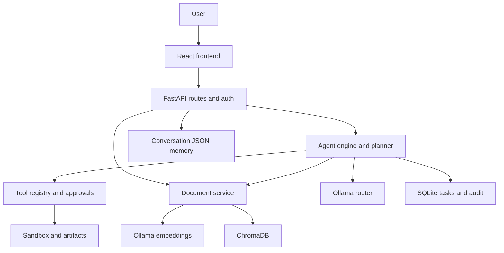
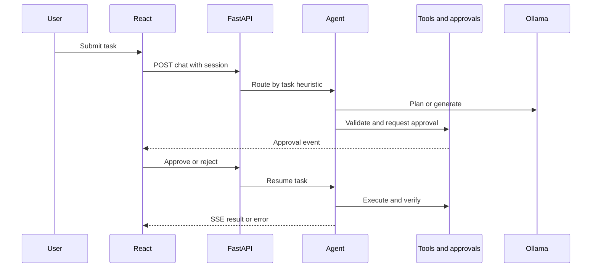

# Architecture audit

Code is authoritative; `docs/ARCHITECTURE.md` is historical and describes non-existent provider files, while `README.md` contains unverified completion/security claims. React 19 and Vite are declared in `frontend/package.json`; FastAPI registration is at `backend/main.py:849`. No tracked CI workflow was found. Python requirements have lower bounds but no lockfile; Node has a lockfile. Configuration examples are `.env.example`, `config/models.yaml`, and `config/tools.yaml`.

`backend/main.py:443` configures directories; lines 484-601 compose router, memory, ingestion, engine, task store. `backend/api/chat.py:71` branches among simple stream, tool loop and planner; SSE flows through frontend `src/api/chat.ts`. Model router supports local Ollama in current code, YAML capability mapping and hardware decisions (`backend/models/router.py:42,247,294`). No inference behavior is verified by architecture inspection.

Five code traces (all runtime E2E unverified):
1. Chat: `ChatView` -> `frontend/src/api/chat.ts` -> `/api/chat` -> `AgentEngine.chat`/`chat_stream` -> router/provider -> persisted memory, SSE or JSON; model failures surfaced by stream wrappers. Simple path defaults retrieval clearance to viewer (`engine.py:142,187`), even for higher roles.
2. Multi-step: same UI/API -> `should_use_planning` (`planner.py:300`) -> `run_agent_task` (`engine.py:762`) -> planner, `PlanValidator`, task store and registry; failures and cancellation have code paths but recovery is not demonstrated live.
3. Document: `DocumentsView` -> `POST /api/documents` (`documents.py:52`) -> `DocumentService.ingest_document` -> parser/chunker/embed/store; chat -> retrieve -> source events. Deletion via route and `service.py:336`. Role-derived clearance is used by document API and tool-stream retrieval.
4. Image: `ChatInput` -> multipart `/api/chat/multimodal` (`chat.py:288`) -> `ImageProcessor` -> `chat_stream_with_tools_multimodal` -> vision and chat model -> SSE. The tools flag has a defective branch (ISS-005); no live image evaluation.
5. Artifact: planned task -> schema validation -> approval bound to task/step/tool/arguments (`approval.py:38,306`) -> registry -> file/DOCX/XLSX tools -> artifact verifier -> `api/artifacts.py`; task approval and cancel routes at `tasks.py:221,303`. Actual whole workflow remains unverified.

Frontend navigation, authentication context, task/document/model/graph components and error display exist in `frontend/src`; responsive and accessibility behavior not tested. Knowledge graph is implemented in `backend/graph`, with static seeds and document integration; the UI's verified/live labels must not be treated as proof of real plant telemetry.
