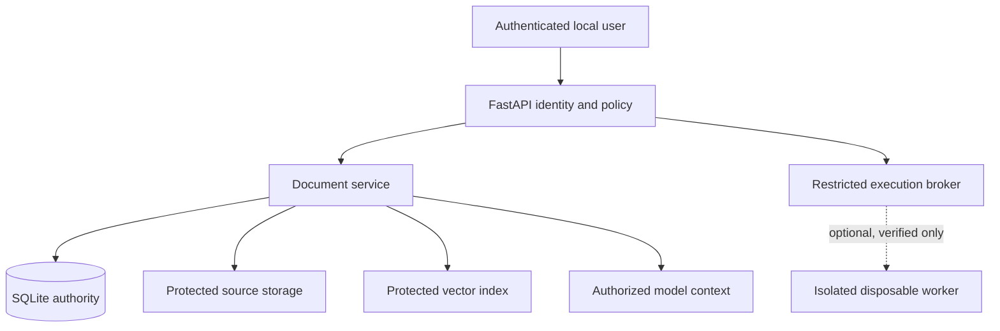

# Batch 2B.2B — document security and isolation architecture decision

Date: 2026-11-08. Branch `phase1-5-recovery-security`, HEAD `beeca449e127e01cb53576ea02c05522855766bd`; pre-existing uncommitted work preserved. This is a **proposed design**, not an implemented or verified authorization boundary. Batch 1 remains PARTIAL; ACTIVE, authorized RAG, task approval/resume and artifact reads remain disabled; Phase 1.5.4 and Phase 2 are **NO-GO**.

## Evidence and current limitations

- `backend/security/provenance_foundation.py` has an unintegrated pending/revoked quarantine table and an unconditional deny-all `document_content_allowed()`. It is not a trusted ACTIVE registry. Existing documents have no proven owner. `backend/rag/ingest.py` uses a legacy ID based on filename and a partial content hash.
- `backend/rag/service.py` currently performs file write, embeddings and vector upsert separately; it does not bind them to an authoritative owner or revision. `backend/rag/store.py` currently backfills missing clearance as `viewer` in vector metadata; **do not treat that metadata as authorization or migrate such records to trusted state**. Public RAG, file-read/list and vector read paths are intentionally withheld as recorded in Batch 2B.2/2B.2A. Raw `_collection` and maintenance functions still exist in the application process.
- `backend/auth/dependencies.py` derives request identity/clearance from the server user; context variables are request snapshots and do not continuously refresh. Conversation JSON ownership and SQLite registry checks do not prove freshness after rollback or an independent writer (`conversation_registry.classify` is conservative).
- Default `code_exec_isolation` is `subprocess`; non-production execution uses a same-context subprocess, AST checks, reduced environment and time/output limits. These do **not** provide filesystem, process or network isolation. `_register_tools` passes only `sandbox_dir` to `create_code_execution`, which falls back to module-global settings; startup diagnostics use `active_cfg`. Custom-settings discrepancies need targeted verification before relying on configuration. The tool description in `backend/main.py` claims sandbox/air-gap guarantees beyond the evidence.
- A Docker execution path constructs `--network none`, non-root, read-only, no-host-mount and resource-limit arguments, and refuses missing local daemon/image. Actual Docker availability, container backend, host integration and isolation have **not** been tested here; process/container escapes and host/daemon privileges remain operational risks. No Docker, WSL2 or Windows Sandbox availability is assumed.
- `ConfigValidator` rejects non-loopback without auth and rejects production subprocess configuration; startup uses it. Its Docker image/daemon checks and a Docker-related PASS message are not proof of verified isolation. Current defaults are loopback and development auth disabled. Deployment must not equate those defaults with organizational multi-user security.
- The reported targeted tests and observed bypasses are synthetic. Full suite remains blocked after automatic security review rejected an earlier attempt involving unidentified telemetry. Python socket guards are not OS-level egress isolation. Nothing in this pass verifies live models, network isolation, browser behavior or Windows reparse-point safety.

## Threat model

| Actor or condition | Required boundary | Scope and limit |
| --- | --- | --- |
| Authenticated user, including guessed IDs | Application authorizes current session/user, resource owner and clearance on each disclosure/action. IDs are references, not bearer authority. | Covers cooperative API/tool paths; cannot protect secrets from code running as the server OS identity. |
| Administrator | Explicit, separately specified and audited administrative grants; no implicit ownership or clearance bypass. | OS administrator is a different and more powerful actor. Until policy exists, existing artifact/task restrictions stand. |
| Malicious document, parser input, prompt injection, model/tool output | Treat contents and proposed tool arguments as untrusted; deterministic authorization, approval binding and output schemas; bounded parsing. | Prompt instructions cannot confer rights. Parser exploit containment requires an OS boundary, not prompt filtering. |
| Arbitrary generated code | Disabled unless a verified isolated worker with no protected-data access is available. | Same-account subprocess, `cwd`, AST checks or Python module privacy are not isolation. Approval does not create an OS boundary. |
| Trusted application and maintenance components | Single reviewed application service owns SQLite, source files and vector data; narrow internal maintenance APIs; no raw data exposed to generated code. | A trusted service compromise or unsafe plugin remains a separate risk; `_collection` naming does not prevent access. |
| Independent local processes | OS identity/ACLs prevent unprivileged processes from reading/writing application data, DB, service IPC and model runtime. | Same-account processes generally have same privileges; file locks alone do not constrain non-cooperating processes. |
| Privileged OS user or administrator | Out of protection scope for app-level confidentiality/integrity; use organizational privileged-access and audit controls. | An admin can often change ACLs, processes and stored data. State this explicitly to operators. |
| Database/filesystem rollback or tampering | Protected backup/restore, maintenance lockout, a separately protected freshness anchor if rollback detection is required, and consistency checks. | SQLite revision counters in the same restored snapshot cannot detect coherent rollback. Without an independent trusted anchor, quarantine until reviewed restore. |
| Network egress/telemetry | Independently administered OS/network boundary and verified allowlist for necessary loopback/local model services. | Library settings, no-network prompts and socket mocks do not prove isolation; unresolved prior telemetry remains blocked. |

## Isolation decision for the local Windows edition

**Immediate deployable posture: disable arbitrary code execution** for document-bearing work until an independently tested isolation backend exists. This is a design decision, not a claim that the current development default has already been disabled. A future implementation must enforce it at startup and tool-dispatch/execution boundaries, including custom settings; denial must not depend solely on the planner. Basic deterministic calculator operations can remain available under their existing controls. This temporarily limits the original sandboxed-code requirement and requires an explicit release gap.

| Option | Assessment / prerequisites |
| --- | --- |
| Separate worker process under the same account | Not sufficient: it inherits the account's filesystem and other OS permissions. Useful for availability and resource management, not confidentiality isolation. |
| Dedicated low-privilege OS account with ACLs | Useful base for a Windows worker, but not alone proof of hostile-code isolation. Provision service/worker identities and ACLs outside the app; deny worker access to protected directories, DB, credentials and dangerous IPC; restrict network, process creation, child lifetime and resources using validated Windows controls. Requires careful token/impersonation, inherited handle and reparse-point testing. |
| Container, VM or Windows sandbox mechanism | Candidate only if already available and independently verified on the target host. Require a pinned pre-existing image, no host data/daemon mounts, egress controls, bounded CPU/memory/processes, ephemeral workspace, strong host/daemon configuration and tested teardown. Docker/WSL2/Windows Sandbox are not presumed installed or suitable. A container alone is not a claim of a complete host-security boundary. |
| Disable arbitrary code | **Chosen default.** No new service or dependency; maintains confidentiality while lifecycle work proceeds. Restore only after an approved, independently verified isolation design. |

For future execution, prefer an independently provisioned restricted worker identity plus a separately verified container/VM boundary when available, with a narrow authenticated broker. The broker supplies only explicitly approved, minimal inputs and accepts bounded outputs; it never mounts uploads, vector data, SQLite, credentials, host sockets or service tokens. Document processing also needs an appropriately isolated parser worker. No package installation, host ACL change, firewall change, model pull or privileged service setup occurred in this pass.

## Proposed trust boundaries

SQLite is the application-level authority; Chroma IDs and filenames are untrusted lookup hints. The SQLite DB, protected files and vector index remain accessible only to the trusted application identity, not the worker. The graph is a proposed topology; no process separation is currently established. Ollama must also be within the trusted data boundary: requests containing document text reach the configured provider, so enforce local-only routing and OS egress restrictions, and treat the model runtime and its logs/cache as sensitive.

## Document lifecycle protocol

The implementation must evolve the existing quarantine mechanism or replace it through a reviewed migration in the **same authoritative application database**, without a competing independently authoritative registry. Proposed records: server-issued opaque document ID; immutable owner/workspace binding; monotonic revision; classification; source-byte SHA-256; opaque server storage reference; chunk IDs, ordered manifest and per-chunk content hashes; index model/version; lifecycle state and timestamps. Conversation association is only accepted from a separately verified server-owned relationship, not supplied IDs or JSON generation fields. Legacy records remain quarantined until a separate explicit ownership/integrity procedure is approved.

| Transition | Authority, transaction and integrity | Failure, recovery and concurrency |
| --- | --- | --- |
| Request → PENDING | Authenticate current user; resolve current clearance server-side; SQLite transaction creates unique ID/owner/classification/revision and expected source digest. Limits apply while streaming. | No filesystem or vector entry grants access. Duplicate request policy uses an owner-scoped idempotency key tied to content digest; collisions or mismatches fail closed. |
| PENDING → file verified | Trusted storage service exclusively creates a server-selected path, bounds writes and verifies reopened file bytes/digest. Prevent symlink/reparse escape with Windows-supported handle-level checks, tested on target filesystem. | SQLite remains PENDING during I/O; partial files quarantined, never silently delete unknown files. Recovery rechecks exact owned path and digest. SQLite and file writes are not atomic. |
| File verified → index verified | Trusted indexer writes revision-bound server chunk IDs and content; computes manifest from trusted parser output and verifies exact expected IDs, source revision and per-chunk hashes against readback. Chroma metadata is a hint, not a grant. | Missing/extra/mismatched entries or vector error remain PENDING. Recovery checks from scratch; no SQLite transaction spans embedding/indexing. Bounded concurrency and idempotent keys prevent unrelated revision overwrite. |
| Verified → ACTIVE | In a short SQLite write transaction, re-read state, owner, revision, current service/session authority and manifest identity; conditional compare-and-swap from PENDING to ACTIVE. No network, parsing, model or filesystem I/O inside the write transaction. | If revocation, mutation, stale evidence, commit failure or ownership change intervenes, remain PENDING/REVOKED. Use a common protocol/lease or isolation to prevent cooperating storage/index changes between verification and activation; a snapshot is insufficient against arbitrary writers. |
| ACTIVE → authorized read | Request-scoped server identity is revalidated against authoritative user/session and current clearance; SQLite resolves ACTIVE owner/workspace, revision and classification; compare returned chunk content/hash to authoritative manifest before disclosure. Conversation/task binding and source dependencies are checked when applicable. | Missing context, mismatches, stale source, external failure, malformed records or unknown provenance deny. Model and client receive only authorized bounded content and safe citations. No filename or vector clearance can authorize. |
| ACTIVE/PENDING → REVOKED | SQLite conditional state transition records revocation before any cleanup; stop new grants and prevent reactivation of the old revision. | Cleanup of verified owned file/index is best effort and separately retryable. A failed deletion never revives access. Coordination must define linearization with in-flight readers and cancel or suppress later protected output once revocation is observed; already emitted bytes cannot be recalled. |
| Restart/recovery | Reconcile PENDING and REVOKED records using trusted manifest and server-owned paths under a single documented lock order; any uncertain state remains unavailable. | No blind promotion, automatic deletion of unknown/legacy files, or resurrection. Detect inconsistencies, report to an authorized operator. SQLite-only rollback cannot be independently detected without a trusted freshness anchor. |

## Retrieval and output contract

One central policy should take **server-resolved** principal/session, action, authoritative document ID/revision and applicable conversation/task context; return a narrow allow/deny decision and versioned evidence, never raw registry records or client-selected clearance. The implementation should fail closed on missing identity, unavailable authority, missing revision, downgraded clearance, deleted/reclassified source, unknown owner or inconsistent hashes. Current `document_content_allowed()` remains deny-all until the positive implementation and all covered boundaries pass tests.

| Consumer | Required integration before restoration |
| --- | --- |
| Retriever and `document_search` | Search candidate IDs may come from Chroma; check each candidate against SQLite and verify its chunk manifest before text is returned. Direct invocation without trusted request context denies. |
| Agent observations, planner synthesis and SSE | Pass only authorized source content and bounded fields; revalidate source and conversation before protected output release. Do not rely on prompts, raw tool dictionaries or stored previous grants. |
| Document list/detail and workspace `file_read`/`file_list` | Authorize each resource, omit unauthorized filenames/metadata; use opaque server references and safe OS-level opens. Do not treat path containment as ownership. |
| Knowledge graph | Authorize every contributing source and revision, including transitive node/edge provenance; withhold mixed content that cannot be separated safely. Static demonstration data must remain labeled. |
| Vector public methods | Gate content-returning APIs. Raw mutation/maintenance stays in trusted service; an OS identity boundary, not underscore naming, keeps untrusted workers away. |
| Conversation and task history | Revalidate all source dependencies, including transitive dependencies, against current authority; withhold unknown legacy or mixed content. Task approval/resume remain denied until their separate provenance and replay checks are complete. |
| Code execution | No source content or raw storage access by default. Any future brokered content must be explicitly authorized and scoped; this cannot be secured by tool-result formatting alone. |

## Dependency-ordered implementation and release gates

1. **Operational prerequisites:** implement a verified disable-by-default code-execution switch across startup and dispatch; decide and provision trusted app/worker identities and storage ACLs. Establish an independently approved offline test environment and preserve the full-suite rejection. Verify configuration parity, no hidden fallback and telemetry monitoring without replaying the rejected request.
2. **Authoritative lifecycle:** evolve the existing SQLite source records with server-issued IDs, immutable owner/workspace and revision, content/manifest hashes, pending/active/revoked states and transactional compare-and-swap. Implement exclusive verified storage and staged indexing with fault-injection tests. No positive retrieval yet.
3. **Authorized retrieval:** implement a single current-principal/source/revision gate and integrate all consumers in the table. Start with synthetic authorized and denied flows; explicitly handle legacy records and preserve intended local-user usability.
4. **Revocation and recovery:** test concurrent request, indexing and revoke, independent process behavior within the stated trust boundary, restart at every lifecycle transition, stale/reclassified/deleted sources, hash/manifest mismatch, backups and rollback response. Define in-flight release semantics.
5. **Restricted workflow restoration and release:** only after source and conversation provenance are verifiable, separately review task approval/resume and artifact authorization, then conduct approved real-model/browser and deployment checks. Maintain auditable evidence for local model operation, sandbox isolation, external-egress denial and the original requirements.

**GO only when** each covered consumer passes real-boundary authorization and negative tests, storage and index completeness/integrity are verified, revocation/recovery races have defined and tested outcomes, arbitrary code and parsers cannot access protected data without approved isolation, and an independently enforced network boundary plus permitted test suite/live integration evidence exists. Any missing authority, uncertain source, missing isolation or unverified release path remains **NO-GO**. No stage, commit, push, merge, deployment, host configuration change or executable security test occurred in this architecture-only pass.
