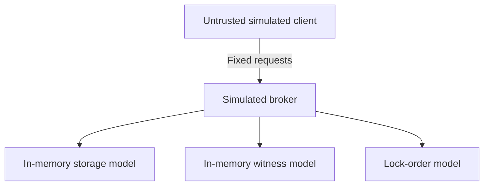
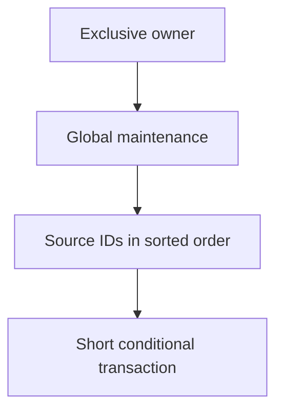
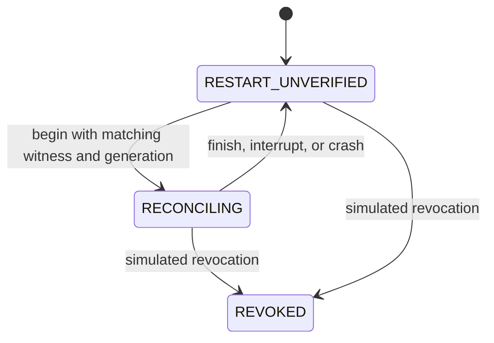

# Batch 2B.3G — Restricted storage broker foundation

Date: 2026-11-12. Branch `phase1-5-recovery-security`. **Release decision: NO-GO.** The new package is an isolated, non-authorizing, single-threaded **simulation**. It is not a Windows service, production broker, durable storage authority, authenticated endpoint, or production recovery implementation. No production authorization gate, FastAPI route, database schema, VM, network setting, offline evidence or `unused` reparse point was changed. Existing tracked and untracked changes were preserved. No commit, push, merge or deployment occurred.

## Structure and contracts

- `prototype/storage_broker/contracts.py`: validated synthetic opaque source/storage identities, operation fence, fixed response/error enums, content-free audit event, capability table and nonimplemented future conditional-generation and witness interfaces.
- `prototype/storage_broker/coordination.py`: deterministic in-memory owner/lock-order checker; no mutex or OS lock.
- `prototype/storage_broker/simulation.py`: built-in in-memory storage and witness, a simulated broker, revocation and crash fixtures; no SQLite, filesystem or Chroma imports.
- `tests/backend/test_batch2b3g_broker.py`: standalone standard-library synthetic tests.
- This report. Nothing imports the prototype from the application.

Requests are exact-shape dictionaries with a fixed `command`. `status` has no parameters; `begin` accepts only an opaque synthetic `source_id` and `expected_generation`; `finish` and `interrupt` accept only the returned opaque `operation_id` and integer generation. Extra keys, invalid identities, booleans used as generations, forged/stale tokens and unknown commands are rejected. Explicit unsafe commands return `UNSUPPORTED`: ingestion, retrieval, source mutation, index writes, recovery commit, authorization, artifact read and code execution. No client-selected path, SQL, collection operation, code or callable is accepted. There is no FastAPI/request-context import or authority propagation.

`Response` contains an enum code, optional operation ID/generation for a simulated begin, simulation state and `authorized=False`. It contains no source content, paths or exception strings. Audit events contain only a fixed recognized command (or `rejected`), result code and simulation marker; they are in-memory diagnostics, not authenticated durable audit evidence. The capability table reports simulation available and OS restriction, independent-process exclusion, verified durable storage, independent witness, production ingestion/retrieval/recovery, authorization, artifact disclosure and code execution **UNSUPPORTED**. Status does not assert a real broker is available.

Source and storage IDs are synthetic typed `src_`/`store_` IDs, not Windows volume/file/collection identity. Operation IDs are generated by UUID4, tracked for uniqueness in the lifetime of each simulation instance and never selected by the request. This is probabilistic and the issued-ID set is volatile: global or durable non-reuse across processes, restoration or restart is **not established**. A returned ID is a simulation bearer token, not authenticated proof of client identity. No transport, peer credentials, request replay protection across restart, or access-control mechanism exists.

## Trust boundaries



The diagram describes test roles, not enforced isolation. All objects run in one Python interpreter with mutable public test state. Callers with code execution can directly access or alter them, and the simulator itself does not authenticate clients. `InMemoryWitness` is an idealized mutable comparison value; it is **not independent**, authenticated, durable or anti-rollback. The future `FreshnessWitness` and `ConditionalGenerationStore` are type-level interfaces only; they do not provide an implementation. A process with OS access can bypass the simulation, replace storage, or impersonate a caller undetected. The real OS-restricted broker and verified durable storage authority remain unsupported, with prerequisites described in 2B.3F.

## Simulated coordination and state



The coordinator checks ranks 0 → 1 → 2 → 3, allows multiple source locks only in strictly increasing key order, and prevents a second simulated owner. The broker models a short conditional transaction by temporarily entering rank 3; **no SQLite connection or transaction is performed**. It retains owner/global/source entries through the simulated operation and releases them at finish/interruption. These are lists and owner fields, not synchronization primitives; the tests interleave operations deterministically rather than testing threads or processes.



Begin checks the synthetic witness is present and equal to the synthetic storage epoch, the configured source ID matches, the source is not revoked and the expected generation matches. Finish checks the same fence/owner, current generation/state, revocation and witness before returning `SIMULATED_COMPLETE`; completion resets to `RESTART_UNVERIFIED`, never VERIFIED or authorized. Revocation advances generation and wins over finish; a stale or forged token cannot release the active owner's modeled locks. Interruption and the test-only crash operation release simulated locks and leave state unverified; repeated finish is stale, and a new begin receives a new process-local ID. Witness mismatch/missing after begin invalidates completion and leaves the record unverified unless revoked. No production provenance record is opened or updated.

## Tests and results

PowerShell commands, external pytest plugin autoload disabled:

```powershell
$env:PYTEST_DISABLE_PLUGIN_AUTOLOAD='1'; $env:PYTHONDONTWRITEBYTECODE='1'; python -I tests/backend/test_batch2b3g_broker.py -v
$env:PYTEST_DISABLE_PLUGIN_AUTOLOAD='1'; $env:PYTHONDONTWRITEBYTECODE='1'; python -I tests/backend/test_batch2b3f_protocol_model.py -v
```

Final result: **20 passed, 0 failed, 0 skipped**: 12 new broker tests and 8 prior state-model tests. The new tests cover malformed/forged requests, extra fields and unknown/unsupported commands, stale IDs, competing simulated broker owners, lock ordering, revocation, missing/rolled-back simulated witness, stale generation, interruption/crash, repeated requests, safe audit projection and rejection of non-synthetic adapters. These are standard-library-only in-memory tests; no real Chroma, Ollama, Docker, VM, external plugin or full suite was run. Full-suite and OS-integration not-run counts were not collected. `git diff --check` returned 0 with pre-existing line-ending warnings; it does not inspect these untracked files.

## Limitations and next steps

The prototype offers no real process exclusivity, Windows service identity, ACL, handle/reparse checks, secure IPC, durable witness, independent storage authority, transaction isolation, atomicity, content manifest validation, crash consistency, authenticated audit, anti-rollback, or source authorization. Simulated lock ordering and revocation tests do not establish real concurrency behavior. UUID4 and a volatile set are not a durable fencing system. No request should be wired to a live application or production storage based on this work.

Next: independently review an OS-backed broker threat model and authenticated IPC; specify durable non-reuse/fencing and a short SQLite CAS protocol; design and test the independently administered freshness witness and crash ordering; specify Windows handle-relative traversal, ACL and writer exclusion; and verify a supported existing-only Chroma snapshot adapter in a separately approved isolated environment. Only after those gates and separate feature-specific authorization reviews should any production integration be considered.
