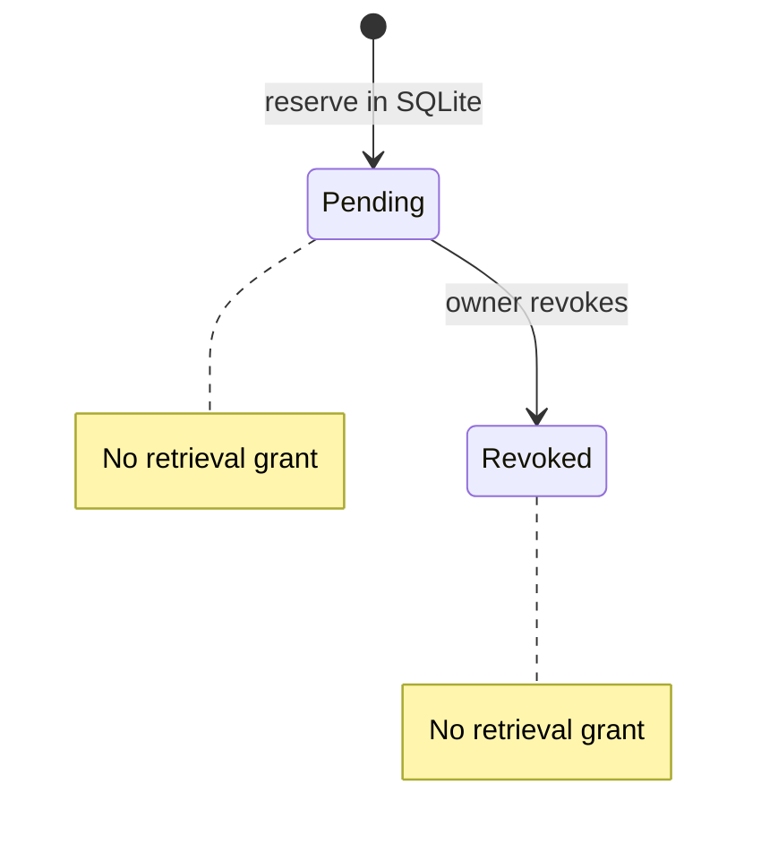

# Batch 2B document lifecycle — PARTIAL / NO-GO

Date: 2026-11-08. Branch `phase1-5-recovery-security`; prior uncommitted work preserved. Batch 1 remains PARTIAL and Phase 1.5.4 and Phase 2 remain NO-GO. No production database, index or upload was modified in this pass.

## Current behavior and trust boundary

`backend/rag/service.py` still parses documents, writes upload bytes and upserts vector chunks as independent operations. `backend/rag/ingest.py` derives its existing document ID from filename and a partial content hash. Chroma metadata and existing records have no authoritative owner. `backend/rag/store.py` includes a legacy metadata reconciliation that may default missing clearance to viewer. Existing retrieval paths still operate as before: **they are not restricted by the new quarantine component**, and must not be described as authorized by it. SQLite conversation registry freshness, independent writers and rollback remain unresolved.

An authoritative document lifecycle and authorized ingestion integration were **not implemented**. Enabling ACTIVE after independently writing filesystem and Chroma would be unsafe without verified complete indexing, source-content binding, failure and revocation coordination, and a retrieval boundary that checks SQLite. No claim of atomicity across those stores is made.

## Implemented non-authorizing schema

`QuarantinedSources` in `backend/security/provenance_foundation.py` remains opt-in and is not instantiated by startup or ingestion. Its existing `quarantined_source_registry` table now receives three additive nullable columns: `content_sha256`, `source_revision`, `classification`. Older rows are preserved and remain untrusted. Existing columns are server-issued `source_id`, untrusted `document_reference`, `owner_id`, `state`, `schema_version`, `created_at`, `revoked_at`.

`reserve_document(bytes)` gets owner and normalized clearance from server request context, creates a random server ID, hashes all supplied bytes with SHA-256, stores revision 1 and `pending`, and never accepts a client-supplied owner or ID. Identical content receives distinct identities. The digest covers the bytes supplied to the method; it **does not verify any persisted file, indexed chunk, ownership of a historical file or current document classification**. No workspace/conversation association is stored. A maximum input size of 32 MiB applies to this unused method. Existing owner-scoped `revoke` marks pending records revoked in a bounded SQLite transaction. `retrieval_eligible` unconditionally returns false; no active state or activation operation exists.



This is a quarantine schema, **not the authoritative schema requested**. The `document_reference` of new records equals the generated source ID, and legacy references remain untrusted. SQLite table constraints and application methods do not protect against malicious database writes or replacement. The standalone policy remains deny-all and is not connected to runtime. There is no process-restart reconciliation beyond preserving pending/revoked rows; no cleanup is performed.

## Required consistency protocol before integration

A future reviewed implementation needs (1) current server-authenticated owner and classification, generated source/revision IDs and full source digest; (2) SQLite pending record before writing; (3) exclusive server-controlled file storage and read-back digest verification; (4) revision-bound vector entries with completeness and integrity checks, treating their metadata only as hints; (5) an activation transaction conditional on still-pending state and verified evidence, with a documented response to independent mutations; (6) retrieval that checks current SQLite state, owner, clearance, content and revision; and (7) revoke in SQLite before best-effort cleanup. Each cross-store step must be restart-recoverable and must quarantine uncertain state. These are design requirements, **not implemented guarantees**. Rollback detection, non-cooperating writers, symlink/reparse behavior and races between authorization and release still require explicit trust assumptions and tests.

## Verification

Before implementation, three new tests failed because `reserve_document` did not exist. After the additive migration, Windows/Python synthetic run with temporary databases and pytest plugin autoload/bytecode disabled:

```powershell
$env:PYTEST_DISABLE_PLUGIN_AUTOLOAD='1'; $env:PYTHONDONTWRITEBYTECODE='1'; python -c "import socket,pytest; original=socket.socket.connect; socket.socket.connect=lambda self,address: original(self,address) if isinstance(address,tuple) and address[0] in ('127.0.0.1','::1') else (_ for _ in ()).throw(OSError('Network disabled for test')); raise SystemExit(pytest.main(['-p','pytest_asyncio.plugin','tests/backend/test_batch2b_document_lifecycle.py','tests/backend/test_batch2a_provenance_foundation.py','tests/backend/test_phase153g_registry.py','tests/backend/test_phase153g_stream_revocation.py','tests/backend/test_phase153c_task_security.py','tests/backend/test_phase153_stabilization.py','tests/backend/test_phase153h_artifact_integrity.py','tests/backend/test_approval.py','-q','-p','no:cacheprovider','--tb=short']))"
# 44 passed, 1 skipped in 5.89s
```

Tests cover server-context owner and clearance, full digest of supplied synthetic bytes, rejected owner argument, pending/revoked ineligibility, restart, concurrent distinct reservations, missing context, legacy schema migration and selected prior task/conversation/artifact/approval guards. The skip is the Windows symlink privilege limitation. No filesystem binding, Chroma indexing, partial-index activation, hash mismatch against persisted files, stale-index revision, cleanup failure or real restart during cross-store work was implemented or tested; there is no eligible state to test. Python socket guards do not establish OS-level network isolation, and the previously rejected full suite was not retried.

Files changed: `backend/security/provenance_foundation.py`, `tests/backend/test_batch2b_document_lifecycle.py`, this report. No staging, commit, push, merge or deployment.

## Batch 2C prerequisites

Decide and implement the authority, storage, activation and cross-store recovery protocol above before connecting ingestion or granting retrieval. Also resolve Batch 1 output-boundary gaps, current clearance refresh, conversation identity freshness and the telemetry/isolation blocker. Preserve task approval/resume, artifact preview/download and verifier restrictions. **Batch 2B PARTIAL; Phase 1.5.4 NO-GO.**
